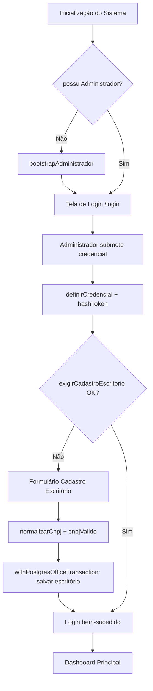

# User Flows & Interaction Diagrams — Sistema de Histórico e Gestão Documental (dist-historico)

## 1. User Personas & Actors
| Ator | Papel | Objetivos Principais | Permissões |
| :--- | :--- | :--- | :--- |
| **Administrador do Escritório** | Configuração inicial e gestão de usuários do escritório | Garantir cadastro do escritório (`exigirCadastroEscritório`), provisionar administrador inicial (`bootstrapAdministrador`), gerenciar acessos | Acesso total ao tenant; pode criar/editar/excluir usuários, configurar parâmetros do escritório, visualizar auditoria completa |
| **Analista de Cadastros** | Manutenção de clientes, contatos e documentos | Cadastrar/consultar clientes (`salvarCliente`, `listarClientes`, `detalheCliente`), contatos (`salvarContato`, `listarContatos`), normalizar dados (`normalizarCnpj`, `normalizarTexto`) | Leitura/escrita em cadastros do próprio escritório; não acessa auditoria de segurança nem administração de usuários |
| **Analista de Documentos/Vínculos** | Indexação de documentos e revisão de vínculos automáticos | Indexar documentos (`indexarMetaDocumento`, `indexarVinculo`), revisar vínculos (`definirVinculo`, `rejeitarVinculo`), resolver pendências (`resolverReferenciasPendentes`), descobrir documentos de clientes (`descobrirDocumentosClientes`) | Leitura/escrita em documentos e vínculos do próprio escritório; pode marcar vínculos como revisados manualmente (prevalecem sobre automação per BR-04) |
| **Auditor/Compliance** | Verificação de conformidade e rastreabilidade | Consultar trilha de auditoria (`auditarSeguranca`, `auditarCadastro`), verificar integridade de arquivos (`hashBytes`), gerar relatórios de conformidade | Leitura em auditoria e relatórios do próprio escritório; não altera cadastros, documentos nem vínculos |
| **Sistema (Automação)** [INFERIDO POR IA — REQUER VALIDAÇÃO HUMANA] | Processos em background agendados | Executar migração retroativa (`indexarArquivosExistentes`), resolver referências pendentes automaticamente quando `referenciasExplicitas` existem, monitorar via `node-cron` | Executa operações transacionais (`withPostgresOfficeTransaction`/`withPostgresGlobalTransaction`) sem intervenção humana; ações auditadas via `auditarSeguranca` |

> **Nota:** As personas acima derivam dos termos do Glossário (BRD Seção 3) e das regras de negócio (BR-01 a BR-19). Atores não presentes no Glossário original (ex.: "Sistema (Automação)") são inferidos e requerem validação humana.

---

## 2. Core User Flows

### Flow 1: Onboarding Inicial do Escritório e Provisionamento de Administrador
* **Gatilho:** Primeira execução do sistema (nenhum escritório cadastrado e nenhum administrador existente — `!possuiAdministrador()`).
* **Ator:** Sistema (Automação) → Administrador do Escritório (primeiro acesso humano).
* **Pré-condições:** Banco de dados inicializado; variáveis de ambiente configuradas (`postgresRuntimeConfigFromEnv`).
* **Resultado esperado:** Escritório cadastrado (`exigirCadastroEscritorio`), conta de administrador criada (`bootstrapAdministrador`), credencial definida (`definirCredencial`), pronto para login.

* **Passos:**
  1. Sistema detecta ausência de administrador (`possuiAdministrador` retorna false) na inicialização.
  2. Sistema executa `bootstrapAdministrador` criando registro de administrador provisório.
  3. Administrador acessa tela de login (`/login`).
  4. Sistema exibe formulário de credencial inicial (e-mail + senha temporária ou token de recuperação).
  5. Administrador submete credencial → `definirCredencial` valida e persiste hash (`hashToken`).
  6. Sistema valida cadastro do escritório (`exigirCadastroEscritorio`) — se incompleto, redireciona para cadastro do escritório.
  7. Administrador preenche dados do escritório (razão social, CNPJ validado via `cnpjValido`/`normalizarCnpj`).
  8. Sistema persiste escritório em transação (`withPostgresOfficeTransaction`).
  9. Login efetuado com sucesso → redireciona para dashboard principal.



* **Estados de UI cobertos:** loading (inicialização), empty (sem escritório cadastrado), error (CNPJ inválido, credencial fraca), success (login ok), disabled (botão salvar desabilitado até CNPJ válido).
* **Métricas instrumentadas neste fluxo:** tempo para primeiro login bem-sucedido, taxa de conclusão do cadastro do escritório, erros de validação de CNPJ.

---

### Flow 2: Cadastro e Consulta de Clientes
* **Gatilho:** Analista de Cadastros acessa "Clientes" → "Novo Cliente" ou lista existente (`listarClientes`).
* **Ator:** Analista de Cadastros.
* **Pré-condições:** Usuário autenticado; escritório ativo (`exigirCadastroEscritorio`).
* **Resultado esperado:** Cliente persistido com CNPJ normalizado e validado, textos normalizados (`normalizarTexto`), disponível para vínculos e documentos.

* **Passos:**
  1. Usuário navega para `/clientes` → sistema chama `listarClientes` (paginado, filtrado por escritório via `withPostgresOfficeTransaction`).
  2. Usuário clica "Novo Cliente" → abre formulário `/clientes/novo`.
  3. Usuário preenche: razão social, CNPJ, endereço, dados complementares.
  4. Em blur/submit do CNPJ: `normalizarCnpj` → `cnpjValido` → feedback imediato (válido/inválido).
  5. Em submit: `normalizarTexto` aplicado a campos textuais.
  6. Sistema executa `salvarCliente` em transação (`withPostgresOfficeTransaction`).
  7. Sucesso: toast "Cliente salvo", redireciona para `/clientes/[id]` (detalhe via `detalheCliente`).
  8. Erro: mensagem inline (CNPJ duplicado no escritório, validação falhou), formulário mantém dados.

```mermaid
graph TD
    A[/clientes - Lista] --> B{Clique Novo Cliente}
    B --> C[/clientes/novo - Formulário]
    C --> D[Preenchimento + blur CNPJ]
    D --> E{normalizarCnpj + cnpjValido}
    E -- Inválido --> F[Erro inline CNPJ]
    F --> D
    E -- Válido --> G[Submit formulário]
    G --> H[normalizarTexto nos campos]
    H --> I[salvarCliente + withPostgresOfficeTransaction]
    I -- Sucesso --> J[Toast sucesso + redirect /clientes/[id]]
    I -- Erro duplicado/validação --> K[Erro inline + mantém formulário]
    K --> D
    J --> L[/clientes/[id] - Detalhe via detalheCliente]
```

* **Estados de UI cobertos:** loading (lista e submit), empty (lista vazia — estado "Nenhum cliente cadastrado"), error (CNPJ inválido, duplicado, erro de rede), success (toast + redirect), disabled (botão salvar desabilitado até CNPJ válido e campos obrigatórios preenchidos).
* **Métricas instrumentadas neste fluxo:** taxa de erro de validação de CNPJ, tempo médio de preenchimento, duplicatas detectadas.

---

### Flow 3: Cadastro e Consulta de Contatos
* **Gatilho:** Analista de Cadastros acessa "Contatos" a partir de um cliente (`/clientes/[id]/contatos`) ou menu global.
* **Ator:** Analista de Cadastros.
* **Pré-condições:** Cliente selecionado existe e pertence ao escritório.
* **Resultado esperado:** Contato vinculado ao cliente, dados normalizados, disponível para referência em documentos.

* **Passos:**
  1. Usuário em `/clientes/[id]` clica aba "Contatos" → `listarContatos` (filtrado por cliente + escritório).
  2. Clica "Novo Contato" → formulário modal ou `/clientes/[id]/contatos/novo`.
  3. Preenche: nome, cargo, e-mail, telefone, observações.
  4. Submit → `normalizarTexto` nos campos textuais → `salvarContato` em transação.
  4. Sucesso: fecha modal/atualiza lista, toast "Contato salvo".
  5. Erro: validação (e-mail duplicado no cliente, campos obrigatórios), mantém formulário.

```mermaid
graph TD
    A[/clientes/[id] - Detalhe] --> B[Aba Contatos: listarContatos]
    B --> C{Clique Novo Contato}
    C --> D[Formulário Contato]
    D --> E[Preenchimento]
    E --> F[Submit]
    F --> G[normalizarTexto]
    G --> H[salvarContato + withPostgresOfficeTransaction]
    H -- Sucesso --> I[Toast + lista atualizada]
    H -- Erro --> J[Erro inline + mantém formulário]
    J --> E
```

* **Estados de UI cobertos:** loading (lista/submit), empty (sem contatos), error (validação), success (toast), disabled (salvar até obrigatórios).
* **Métricas instrumentadas neste fluxo:** contatos por cliente, taxa de preenchimento de campos opcionais.

---

### Flow 4: Indexação de Documento no Histórico
* **Gatilho:** Analista de Documentos/Vínculos acessa "Documentos" → "Indexar Novo" ou arrasta arquivo na zona de drop.
* **Ator:** Analista de Documentos/Vínculos.
* **Pré-condições:** Escritório ativo; arquivo atende `arquivoPermitido`; formato detectado por `detectarFormato`.
* **Resultado esperado:** Metadados do documento persistidos (`indexarMetaDocumento`), bytes lidos (`lerDocumentoBytes`), hash gerado (`hashBytes`), cabeçalho extraído (`extrairCabecalho` sem IA), pronto para vínculos.

* **Passos:**
  1. Usuário em `/documentos` clica "Indexar" → abre seletor/área de drop.
  2. Seleciona arquivo → cliente valida `arquivoPermitido` (extensão, tamanho) → `detectarFormato` (PDF, DOCX, etc.).
  3. Se inválido: erro "Formato não permitido", fluxo encerra.
  4. Sistema lê bytes (`lerDocumentoBytes`) → calcula `hashBytes` → exibe preview de metadados (nome, tamanho, hash, formato).
  5. Usuário confirma → sistema extrai cabeçalho (`extrairCabecalho`) — **sem IA**, conforme BR-11.
  6. Usuário revisa/edita metadados extraídos (tipo, data, partes, número do processo, etc.).
  7. Submit → `indexarMetaDocumento` persiste metadados + hash em transação (`withPostgresOfficeTransaction`).
  8. Sucesso: toast "Documento indexado", redireciona para `/documentos/[id]` (detalhe com `lerDocumento`).
  9. Erro: mensagem (hash duplicado, falha de leitura), opção de retry.

```mermaid
graph TD
    A[/documentos - Lista] --> B{Clique Indexar / Drop}
    B --> C[Seleção de Arquivo]
    C --> D{arquivoPermitido + detectarFormato}
    D -- Não --> E[Erro: Formato/Tamanho não permitido]
    E --> C
    D -- Sim --> F[lerDocumentoBytes + hashBytes]
    F --> G[Preview: nome, tamanho, hash, formato]
    G --> H[extrairCabecalho (sem IA)]
    H --> I[Edição/Revisão de Metadados]
    I --> J[Submit indexarMetaDocumento]
    J --> K{withPostgresOfficeTransaction OK?}
    K -- Sim --> L[Toast + redirect /documentos/[id]]
    K -- Não --> M[Erro: hash duplicado / falha persistência]
    M --> I
```

* **Estados de UI cobertos:** loading (leitura bytes, extração, persistência), empty (lista vazia), error (formato inválido, hash duplicado, falha leitura), success (toast + redirect), disabled (botão indexar até arquivo válido selecionado).
* **Métricas instrumentadas neste fluxo:** tempo de extração de cabeçalho por formato, taxa de rejeição por `arquivoPermitido`, duplicatas por hash.

---

### Flow 5: Gestão de Vínculos — Indexação, Revisão Manual e Resolução de Pendências
* **Gatilho:** Analista de Documentos/Vínculos acessa "Vínculos" → "Pendentes" (`resolverReferenciasPendentes`) ou cria vínculo direto (`indexarVinculo`).
* **Ator:** Analista de Documentos/Vínculos.
* **Pré-condições:** Documentos e clientes já indexados/cadastrados no mesmo escritório.
* **Resultado esperado:** Vínculos confirmados (`definirVinculo`) ou rejeitados (`rejeitarVinculo`), pendências resolvidas, consolidações validadas ou invalidadas (`invalidarConsolidacao`).

* **Passos — 5A: Indexação Automática com Referências Explícitas (Aditivo → CCT)**
  1. Sistema (automação `node-cron`) ou usuário dispara `indexarVinculo` para documento recém-indexado.
  2. Sistema verifica `ehAditivoCct` + `ehCct` + `referenciasExplicitas`.
  3. Se `referenciasExplicitas` verdadeiro: cria vínculo candidato **pendente** (não confirmado automaticamente).
  4. Se falso: registra como referência pendente para revisão manual.

* **Passos — 5B: Revisão Manual de Vínculos Pendentes**
  1. Usuário acessa `/vinculos/pendentes` → lista via `resolverReferenciasPendentes` (filtros: tipo, data, confiança).
  2. Clica em item → abre painel lateral `/vinculos/[id]/revisar` com contexto: documento origem, documento destino, evidências (`contextoDocumentoCliente`).
  3. Usuário decide:
     - **Confirmar:** `definirVinculo` → vínculo torna-se **manual** (prevalece sobre automação per BR-04).
     - **Rejeitar:** `rejeitarVinculo` → marca como inválido, registra justificativa.
     - **Deferir:** mantém pendente, adiciona observação.
  4. Ação persiste em transação (`withPostgresOfficeTransaction`).
  5. Lista atualiza em tempo real (ou via refresh).

* **Passos — 5C: Descoberta de Documentos de Clientes (`descobrirDocumentosClientes`)**
  1. Usuário em `/clientes/[id]` clica "Descobrir Documentos".
  2. Sistema executa `descobrirDocumentosClientes` → retorna candidatos com score/evidências.
  3. Para cada candidato: `decidirDocumentoCliente` → **Confirmar** (vínculo manual) / **Rejeitar** / **Aguardar**.
  4. BR-06: confirmação automática **somente** com evidências suficientes; coincidências parciais → revisão manual.

* **Passos — 5D: Invalidação de Consolidação**
  1. Usuário identifica consolidação incorreta → `invalidarConsolidacao`.
  2. Sistema reverte registros ao estado anterior ou marca como não válidos (BR-19), preservando rastreabilidade.

```mermaid
graph TD
    subgraph Auto[Automação / Indexação]
        A1[Documento indexado] --> A2{ehAditivoCct + ehCct + referenciasExplicitas?}
        A2 -- Sim --> A3[Cria vínculo candidato PENDENTE]
        A2 -- Não --> A4[Registra referência pendente]
    end

    subgraph Manual[Revisão Manual - Analista]
        B1[/vinculos/pendentes - resolverReferenciasPendentes] --> B2[Seleciona item]
        B2 --> B3[/vinculos/[id]/revisar - contextoDocumentoCliente]
        B3 --> B4{Decisão}
        B4 -- Confirmar --> B5[definirVinculo -> MANUAL (BR-04)]
        B4 -- Rejeitar --> B6[rejeitarVinculo + justificativa]
        B4 -- Deferir --> B7[Mantém pendente + observação]
        B5 --> B8[withPostgresOfficeTransaction]
        B6 --> B8
        B7 --> B1
        B8 --> B1
    end

    subgraph Discovery[Descoberta Cliente-Documento]
        C1[/clientes/[id] - Descobrir Documentos] --> C2[descobrirDocumentosClientes]
        C2 --> C3[Lista candidatos + evidências]
        C3 --> C4{decidirDocumentoCliente}
        C4 -- Evidências suficientes (BR-06) --> C5[Confirmar -> vínculo manual]
        C4 -- Parcial --> C6[Revisão manual]
        C4 -- Rejeitar --> C7[Descartar candidato]
    end

    subgraph Invalidation[Invalidação]
        D1[Identifica consolidação incorreta] --> D2[invalidarConsolidacao]
        D2 --> D3[Reverte ou marca inválido + auditoria (BR-19)]
    end
```

* **Estados de UI cobertos:** loading (lista pendentes, carregamento contexto), empty (nenhum vínculo pendente), error (falha transação, concorrência), success (toast "Vínculo confirmado/rejeitado"), disabled (botões confirmar/rejeitar até justificativa preenchida se obrigatória).
* **Métricas instrumentadas neste fluxo:** % de vínculos confirmados vs. rejeitados, tempo médio de revisão, backlog de pendências, taxa de invalidação de consolidações.

---

### Flow 6: Processamento de CCTs e Aditivos — Validação e Renderização
* **Gatilho:** Documento indexado identificado como CCT (`ehCct`) ou Aditivo (`ehAditivoCct`); analista acessa detalhe do documento.
* **Ator:** Analista de Documentos/Vínculos.
* **Pré-condições:** Documento indexado com metadados completos; cabeçalho extraído.
* **Resultado esperado:** Extração validada (`validarExtracaoCct`), markdown contratual renderizado (`renderizarCctMarkdown`), evidências registradas separadamente (BR-10).

* **Passos:**
  1. Usuário em `/documentos/[id]` (tipo CCT/Aditivo) clica "Validar Extração".
  2. Sistema executa `validarExtracaoCct` → compara conteúdo do documento com dados extraídos.
  3. Se divergências: lista campos faltantes/incorretos → usuário corrige manualmente.
  4. Usuário clica "Gerar Markdown Contratual" → `renderizarCctMarkdown` produz apenas layout acordado (BR-10).
  5. Markdown exibido em preview (readonly) → opção copiar/baixar.
  6. Evidências/justificativas permanecem no sistema (não no markdown).
  7. Ação auditada (`auditarCadastro`).

```mermaid
graph TD
    A[/documentos/[id] - Tipo CCT/Aditivo] --> B[Clique Validar Extração]
    B --> C[validarExtracaoCct]
    C --> D{Divergências?}
    D -- Sim --> E[Lista campos faltantes/incorretos]
    E --> F[Correção manual]
    F --> C
    D -- Não --> G[Clique Gerar Markdown]
    G --> H[renderizarCctMarkdown]
    H --> I[Preview Markdown (readonly)]
    I --> J[Copiar/Baixar]
    J --> K[auditarCadastro]
```

* **Estados de UI cobertos:** loading (validação, renderização), error (validação falha, markdown vazio), success (preview pronto), disabled (botão gerar markdown até validação ok).
* **Métricas instrumentadas neste fluxo:** taxa de divergências na extração, tempo de validação, uso do markdown gerado.

---

### Flow 7: Geração de Relatórios do Histórico (HTML/PDF)
* **Gatilho:** Analista de Documentos/Vínculos ou Auditor acessa "Relatórios" → define filtros → gera.
* **Ator:** Analista de Documentos/Vínculos | Auditor/Compliance.
* **Pré-condições:** Dados indexados e vinculados no período/escopo desejado; arquivos íntegros (`hashBytes` confere).
* **Resultado esperado:** Relatório HTML (`renderizarRelatorioHtml`) e/ou PDF (`gerarPdfRelatorio`) com dados do histórico, textos escapados (`escaparHtml`), integridade verificada.

* **Passos:**
  1. Usuário acessa `/relatorios` → formulário de filtros: período, escritório (se admin global), tipos de documento, status de vínculo, cliente.
  2. Submit → sistema consulta dados (transação `withPostgresOfficeTransaction` ou `withPostgresGlobalTransaction` se admin).
  3. Para cada documento incluído: `lerDocumentoBytes` + `hashBytes` → verifica integridade (BR-08).
  4. Sistema monta HTML via `renderizarRelatorioHtml` → aplica `escaparHtml` em todos os textos (BR-11).
  5. Usuário visualiza preview HTML → opção "Gerar PDF".
  6. `gerarPdfRelatorio` converte HTML → PDF (provavelmente via `playwright` headless — [INFERIDO POR IA — REQUER VALIDAÇÃO HUMANA]).
  7. Download do PDF ou envio por e-mail (via `nodemailer` — [INFERIDO POR IA — REQUER VALIDAÇÃO HUMANA]).
  8. Ação auditada (`auditarSeguranca`).

```mermaid
graph TD
    A[/relatorios - Filtros] --> B[Submit filtros]
    B --> C[Consulta dados + withPostgresOfficeTransaction]
    C --> D[Para cada doc: lerDocumentoBytes + hashBytes]
    D --> E{Integridade OK?}
    E -- Não --> F[Alerta: arquivo corrompido/alterado - exclui do relatório]
    E -- Sim --> G[renderizarRelatorioHtml + escaparHtml]
    G --> H[Preview HTML]
    H --> I{Gerar PDF?}
    I -- Sim --> J[gerarPdfRelatorio (playwright headless?)]
    J --> K[Download PDF]
    I -- Não --> K
    K --> L[auditarSeguranca]
    F --> L
```

* **Estados de UI cobertos:** loading (consulta, verificação integridade, renderização HTML, geração PDF), empty (nenhum dado nos filtros), error (integridade falha, falha geração PDF), success (preview + download), disabled (botão gerar PDF até preview HTML pronto).
* **Métricas instrumentadas neste fluxo:** tempo de geração HTML vs PDF, taxa de falha de integridade, volume de relatórios por período.

---

### Flow 8: Autenticação — Login, Logout, Recuperação de Senha
* **Gatilho:** Usuário não autenticado acessa rota protegida → redirecionado para `/login`; ou usuário clica "Esqueci senha".
* **Ator:** Qualquer usuário (Administrador, Analista, Auditor).
* **Pré-condições:** Escritório cadastrado; pelo menos um administrador existe (`bootstrapAdministrador` já executado).
* **Resultado esperado:** Sessão autenticada (token/JWT ou cookie) ou credencial redefinida com segurança.

* **Passos — 8A: Login**
  1. Usuário em `/login` → preenche e-mail + senha.
  2. Submit → `login` valida credencial (hash armazenado via `hashToken`).
  3. Sucesso: cria sessão → redireciona para `/dashboard` (ou rota original).
  4. Falha: erro "Credenciais inválidas" (genérico, não revela se e-mail existe), contador de tentativas → `auditarSeguranca`.

* **Passos — 8B: Logout**
  1. Usuário clica "Sair" → `logout` invalida sessão/token → redireciona `/login`.

* **Passos — 8C: Recuperação de Senha**
  1. Usuário em `/login` clica "Esqueci senha" → `/recuperar/solicitar`.
  2. Informa e-mail → `solicitarRecuperacao` → gera token, `hashToken`, persiste, envia e-mail via `nodemailer` (SMTP).
  3. Usuário clica link no e-mail → `/recuperar/[token]`.
  4. Sistema valida token (hash) → exibe formulário nova senha.
  5. Submit → `recuperar` + `definirCredencial` (novo hash) → invalida token usado.
  6. Sucesso: redireciona `/login` com toast "Senha alterada, faça login".

```mermaid
graph TD
    subgraph Login
        A1[Acesso rota protegida] --> A2[/login]
        A2 --> A3[Preenche e-mail + senha]
        A3 --> A4[login + valida hashToken]
        A4 -- Sucesso --> A5[Sessão + redirect /dashboard]
        A4 -- Falha --> A6[Erro genérico + auditarSeguranca]
        A6 --> A3
    end

    subgraph Logout
        B1[Clique Sair] --> B2[logout]
        B2 --> B3[/login]
    end

    subgraph Recuperacao
        C1[/login - Esqueci senha] --> C2[/recuperar/solicitar]
        C2 --> C3[Informa e-mail]
        C3 --> C4[solicitarRecuperacao + hashToken + nodemailer]
        C4 --> C5[E-mail enviado]
        C5 --> C6[Usuário clica link /recuperar/[token]]
        C6 --> C7[Valida token hash]
        C7 -- Válido --> C8[Formulário nova senha]
        C8 --> C9[recuperar + definirCredencial + invalida token]
        C9 --> C10[Toast + redirect /login]
        C7 -- Inválido/Expirado --> C11[Erro + link para nova solicitação]
    end
```

* **Estados de UI cobertos:** loading (submit login, envio e-mail, validação token), error (credenciais inválidas, token expirado, e-mail não cadastrado — mensagem genérica), success (login ok, e-mail enviado, senha alterada), disabled (botões até campos preenchidos).
* **Métricas instrumentadas neste fluxo:** taxa de sucesso login, tentativas falhas por usuário/hora, tempo de recuperação de senha, e-mails bounce.

---

### Flow 9: Auditoria e Trilha de Segurança
* **Gatilho:** Auditor/Compliance acessa `/auditoria` (segurança) ou `/auditoria/cadastros`.
* **Ator:** Auditor/Compliance.
* **Pré-condições:** Permissão de leitura de auditoria no escritório.
* **Resultado esperado:** Lista paginada/filtrada de eventos (`auditarSeguranca`, `auditarCadastro`) com detalhes: ator, ação, entidade, timestamp, IP/contexto.

* **Passos:**
  1. Usuário acessa `/auditoria` → abas "Segurança" / "Cadastros".
  2. Filtros: período, ator, tipo de ação, entidade afetada, resultado (sucesso/falha).
  3. Sistema consulta via `auditarSeguranca` ou `auditarCadastro` (read-only, `withPostgresOfficeTransaction`).
  4. Resultados em tabela paginada → clique em linha expande detalhes (payload antes/depois, metadados).
  5. Opção exportar CSV/PDF (reutiliza `renderizarRelatorioHtml` + `gerarPdfRelatorio`).
  6. Acesso à própria auditoria também auditado (`auditarSeguranca`).

```mermaid
graph TD
    A[/auditoria - Abas Segurança/Cadastros] --> B[Filtros: período, ator, ação, entidade]
    B --> C[Submit filtros]
    C --> D[auditarSeguranca / auditarCadastro]
    D --> E[Tabela paginada]
    E --> F{Clique linha}
    F --> G[Detalhe expandido: payload antes/depois, IP, user-agent]
    G --> H{Exportar?}
    H -- Sim --> I[renderizarRelatorioHtml + gerarPdfRelatorio]
    H -- Não --> E
    I --> J[Download]
    J --> K[auditarSeguranca (acesso à auditoria)]
```

* **Estados de UI cobertos:** loading (consulta, exportação), empty (nenhum evento nos filtros), error (falha consulta), success (tabela populada), disabled (exportar até consulta concluída).
* **Métricas instrumentadas neste fluxo:** volume de eventos por tipo, tempo de resposta da consulta, uso de exportação.

---

### Flow 10: Migração Retroativa de Arquivos Existentes (`indexarArquivosExistentes`)
* **Gatilho:** Administrador do Escritório inicia migração via `/admin/migracao` (onboarding de novo tenant ou migração de versão).
* **Ator:** Administrador do Escritório | Sistema (Automação agendada).
* **Pré-condições:** Diretório de arquivos legados acessível; escritório cadastrado.
* **Resultado esperado:** Arquivos legados indexados no histórico com metadados, hashes, vínculos candidatos criados (pendentes), sem sobrescrever vínculos manuais (BR-04).

* **Passos:**
  1. Administrador acessa `/admin/migracao` → informa caminho/origem dos arquivos legados.
  2. Sistema valida acesso → inicia `indexarArquivosExistentes` (pode ser job `node-cron` de longa duração).
  3. Para cada arquivo: `arquivoPermitido` → `detectarFormato` → `lerDocumentoBytes` → `hashBytes` → `extrairCabecalho` → `indexarMetaDocumento`.
  4. Se arquivo corresponde a CCT/Aditivo: `indexarVinculo` → cria vínculos candidatos **pendentes** (não confirmados, BR-04).
  5. Progresso exibido em tempo real (WebSocket ou polling — [INFERIDO POR IA — REQUER VALIDAÇÃO HUMANA]).
  6. Conclusão: relatório resumido (total processados, indexados, erros, vínculos candidatos criados).
  7. Administrador revisa pendentes via Flow 5B.
  8. Auditoria completa (`auditarSeguranca`, `auditarCadastro`).

```mermaid
graph TD
    A[/admin/migracao] --> B[Informa origem arquivos legados]
    B --> C[Valida acesso + inicia indexarArquivosExistentes]
    C --> D[Loop para cada arquivo]
    D --> E{arquivoPermitido + detectarFormato}
    E -- Não --> F[Registra erro + continua]
    E -- Sim --> G[lerDocumentoBytes + hashBytes + extrairCabecalho]
    G --> H[indexarMetaDocumento]
    H --> I{ehCct/ehAditivoCct?}
    I -- Sim --> J[indexarVinculo -> candidato PENDENTE (BR-04)]
    I -- Não -->I -- Não --> K
    J --> K
    F --> K
    K --> L{Fim dos arquivos?}
    L -- Não --> D
    L -- Sim --> M[Relatório resumido: processados, indexados, erros, vínculos pendentes]
    M --> N[Administrador revisa pendentes no Flow 5B]
    N --> O[auditarSeguranca + auditarCadastro]
```

* **Estados de UI cobertos:** loading (barra de progresso, contador), empty (nenhum arquivo na origem), error (arquivo corrompido, permissão negada, formato não suportado — listados no relatório), success (relatório final), disabled (botão iniciar até origem válida).
* **Métricas instrumentadas neste fluxo:** taxa de sucesso indexação, volume de vínculos candidatos gerados, tempo total de migração, erros por tipo.

---

### Flow 11: Exclusão de Cadastro (`excluirCadastro`)
* **Gatilho:** Analista de Cadastros ou Administrador solicita exclusão em `/clientes/[id]` ou `/contatos/[id]`.
* **Ator:** Analista de Cadastros | Administrador do Escritório.
* **Pré-condições:** Cadastro existe no escritório; usuário confirma ação irreversível.
* **Resultado esperado:** Registro removido permanentemente; vínculos históricos associados tratados conforme política (BR-18 — [INFERIDO POR IA — REQUER VALIDAÇÃO HUMANA] quanto a cascata/órfãos).

* **Passos:**
  1. Usuário em detalhe do cliente/contato clica "Excluir" → abre modal de confirmação com aviso: "Ação permanente. Vínculos históricos associados serão [desvinculados/mantidos como órfãos/removidos] — confirmar?".
  2. Usuário digita nome do cliente/contato para confirmar (prevenção de clique acidental).
  3. Submit → `excluirCadastro` em transação (`withPostgresOfficeTransaction`).
  4. Sucesso: toast "Excluído permanentemente", redireciona para lista.
  5. Erro: mensagem (falha transação, restrição de integridade não prevista), mantém registro.
  6. Auditoria (`auditarCadastro`).

```mermaid
graph TD
    A[/clientes/[id] ou /contatos/[id]] --> B[Clique Excluir]
    B --> C[Modal: aviso irreversível + digitação nome para confirmar]
    C --> D{Confirmação exata?}
    D -- Não --> C
    D -- Sim --> E[excluirCadastro + withPostgresOfficeTransaction]
    E -- Sucesso --> F[Toast + redirect lista]
    E -- Erro --> G[Erro + mantém registro]
    F --> H[auditarCadastro]
    G --> H
```

* **Estados de UI cobertos:** loading (exclusão), error (falha transação), success (toast + redirect), disabled (botão confirmar no modal até digitação exata).
* **Métricas instrumentadas neste fluxo:** frequência de exclusões, taxa de cancelamento no modal, erros de integridade.

---

## 3. Edge Cases & Error Flows
| Cenário | Tratamento na UI | Mensagem exibida |
| :--- | :--- | :--- |
| Sessão expirada durante fluxo (qualquer) | Intercepta 401/419 → salva estado local (form data, scroll) → redireciona `/login?redirect=...` → após login restaura estado | "Sua sessão expirou. Faça login para continuar." |
| CNPJ inválido em `salvarCliente` / `descobrirDocumentosClientes` | Validação síncrona no blur + assíncrona no submit; destaca campo; desabilita salvar | "CNPJ inválido. Verifique os 14 dígitos." |
| Hash duplicado ao indexar documento (`indexarMetaDocumento`) | Detecta no submit → exibe link para documento existente (`/documentos/[existenteId]`) | "Documento idêntico já indexado em [data]. [Ver documento existente]" |
| Vínculo manual existente ao processar automação (`indexarArquivosExistentes`, `indexarVinculo`) | BR-04: automação cria apenas candidato pendente; não sobrescreve; UI mostra badge "Revisado manualmente" | "Este vínculo foi confirmado manualmente em [data] por [usuário]. A automação não o alterará." |
| Arquivo corrompido/alterado na geração de relatório (`hashBytes` diverge) | Exclui do relatório; lista em seção "Arquivos com integridade comprometida" no final do PDF/HTML | "Aviso: [N] arquivo(s) falharam na verificação de integridade e foram omitidos. Consulte a auditoria." |
| Token de recuperação expirado/usado (`/recuperar/[token]`) | Invalida token → exibe botão "Solicitar novo e-mail" → volta para `/recuperar/solicitar` | "Link inválido ou expirado. [Solicitar novo e-mail de recuperação]" |
| Falha de envio de e-mail (`nodemailer` SMTP down) em `solicitarRecuperacao` | Retry automático (3x com backoff) → se persistir: loga erro, exibe "Tente novamente em alguns minutos" + opção "Copiar link de recuperação" (se token gerado) | "Não foi possível enviar o e-mail. Tente novamente ou contate o administrador." |
| Concorrência otimista em `definirVinculo` / `rejeitarVinculo` (dois analistas no mesmo item) | Versionamento/timestamp na entidade → 409 Conflict → recarrega contexto → notifica "Outro usuário atualizou este vínculo. Revise as alterações." | "Conflito: o vínculo foi alterado por outro usuário. A página será atualizada." |
| Migração `migrarCadastros` / `migrarAutenticacao` falha no meio | Transação global (`withPostgresGlobalTransaction`) → rollback total → relatório de erro detalhado → opção "Retry migração" | "Migração falhou na etapa [X]. Nenhuma alteração foi aplicada. [Ver log] [Tentar novamente]" |
| Escritório sem cadastro (`exigirCadastroEscritorio` falha) em qualquer operação protegida | Bloqueia operação → redireciona `/admin/cadastro-escritorio` (apenas admins) ou exibe banner "Configure seu escritório para continuar" | "Seu escritório não está cadastrado. Contate o administrador." |

---

## 4. Cross-Flow Dependencies
* **Flow 1 (Onboarding)** deve concluir antes de **qualquer outro fluxo** — `exigirCadastroEscritorio` e `possuiAdministrador` são guards globais.
* **Flow 2 (Clientes)** e **Flow 3 (Contatos)** são pré-requisitos para **Flow 5C (Descoberta Cliente-Documento)** e **Flow 5 (Vínculos)** — não é possível vincular documento a cliente inexistente.
* **Flow 4 (Indexação Documento)** precede **Flow 5 (Vínculos)**, **Flow 6 (CCT/Aditivo)**, **Flow 7 (Relatórios)**, **Flow 10 (Migração)** — documentos precisam existir com hash íntegro.
* **Flow 5A (Indexação Automática)** alimenta **Flow 5B (Revisão Manual)** — pendências só existem se houver indexação prévia.
* **Flow 6 (Validação CCT)** depende de **Flow 4** (documento indexado) e **Flow 5** (vínculos aditivo-CCT resolvidos para contexto completo).
* **Flow 7 (Relatórios)** consome dados de **Flows 2, 3, 4, 5, 6** — integridade verificada via `hashBytes` (BR-08).
* **Flow 8 (Auth)** é transversal — todos os fluxos autenticados requerem sessão válida; `auditarSeguranca` registra acessos em todos.
* **Flow 9 (Auditoria)** observa todos os fluxos — leitura de auditoria também é auditada.
* **Flow 10 (Migração)** executa **Flow 4 + 5A** em lote — resultado vai para **Flow 5B**.
* **Flow 11 (Exclusão)** impacta **Flow 5** (vínculos órfãos) e **Flow 7** (relatórios históricos) — BR-18 requer validação humana sobre cascata.

---

## 5. Acessibilidade nos Fluxos
* **Navegação por teclado:**
  - Ordem de tab lógica: cabeçalho → navegação principal → conteúdo (formulários, tabelas, botões) → rodapé.
  - `Tab`/`Shift+Tab` entre campos; `Enter` submete formulários; `Esc` fecha modais/dropdowns.
  - Atalhos: `Alt+1` Dashboard, `Alt+2` Clientes, `Alt+3` Documentos, `Alt+4` Vínculos, `Alt+5` Relatórios, `Alt+6` Auditoria, `Alt+0` Perfil/Sair.
  - Tabelas navegáveis com setas (linha/coluna) via `role="grid"` e `aria-rowindex`/`aria-colindex`.
* **Leitores de tela:**
  - Todos os inputs com `<label>` associado (`for`/`id`); mensagens de erro via `aria-describedby` + `role="alert"` (toasts) ou `aria-live="polite"`.
  - Estados de loading: `aria-busy="true"` no container + `aria-live="assertive"` para anúncio "Carregando..." / "Concluído".
  - Tabelas: `<caption>` descritivo; cabeçalhos `<th scope="col">`; linhas com `aria-selected` quando aplicável.
  - Modais: `role="dialog" aria-modal="true" aria-labelledby="modal-title"`; foco trapado; `Esc` fecha e retorna foco ao gatilho.
  - Progresso de migração (Flow 10): `role="progressbar" aria-valuemin="0" aria-valuemax="100" aria-valuenow="..."` + anúncio de marcos (ex.: "500 de 1.200 arquivos processados").
  - Validação CNPJ: anúncio imediato no blur ("CNPJ válido" / "CNPJ inválido, verifique os dígitos").
  - Textos escapados (`escaparHtml`) garantem que conteúdo dinâmico em relatórios/preview não quebre leitura.
* **Contraste e zoom:** Cores respeitam WCAG AA (4.5:1 texto normal, 3:1 texto grande/UI); layout responsivo até 400% zoom sem perda de função.
* **Redução de movimento:** Animações/transições desativadas via `@media (prefers-reduced-motion: reduce)`.

---

## 6. Referências
* **Wireframes/Protótipos:** [ENTRADA HUMANA NECESSÁRIA — não gerado a partir do código]
* **Use Cases relacionados:** [OMITIDO — artefato use-cases não disponível no contexto]
* **Artefatos-fonte consultados:**
  - Business Requirements Document (BRD) — Seções 1 a 12 (Glossário, Regras de Negócio BR-01 a BR-19, Personas inferidas)
  - Stack Tecnológica Verificada (package.json): `better-sqlite3`, `pg`, `vue`, `vite`, `zod`, `nodemailer`, `playwright`, `pdf-parse`, `word-extractor`, `node-cron`, `html-entities`, `dotenv`
* **Rastreabilidade de regras de negócio aplicadas nos fluxos:**
  - BR-01, BR-02 → Flows 2, 3, 5C (normalização/validação)
  - BR-03 → Flow 1, todos (guard `exigirCadastroEscritorio`)
  - BR-04 → Flows 5A, 5B, 10 (prevalência manual)
  - BR-05 → Flow 5A (`referenciasExplicitas`)
  - BR-06 → Flow 5C (`descobrirDocumentosClientes`)
  - BR-07 → Flow 4 (`arquivoPermitido`, `detectarFormato`)
  - BR-08 → Flows 4, 7, 10 (`lerDocumentoBytes`, `hashBytes`)
  - BR-09 → Flow 6 (`validarExtracaoCct`)
  - BR-10 → Flow 6 (`renderizarCctMarkdown`)
  - BR-11 → Flow 7 (`escaparHtml`, sem IA)
  - BR-12 → Flows 8, 9, 10, 11 (`auditarSeguranca`, `auditarCadastro`)
  - BR-13 → Flow 8 (`hashToken`, `definirCredencial`)
  - BR-14 → Flow 1 (`bootstrapAdministrador`, `possuiAdministrador`)
  - BR-15 → Flow 1 (`postgresRuntimeConfigFromEnv`, `validarPapelRuntimePostgres`)
  - BR-16 → Todos os writes (`withPostgresOfficeTransaction`, `withPostgresGlobalTransaction`, `withPostgresTransaction`)
  - BR-17 → Flow 10 (`migrarCadastros`, `migrarAutenticacao` — inferido)
  - BR-18 → Flow 11 (`excluirCadastro` — [INFERIDO POR IA — REQUER VALIDAÇÃO HUMANA])
  - BR-19 → Flow 5D (`invalidarConsolidacao`)