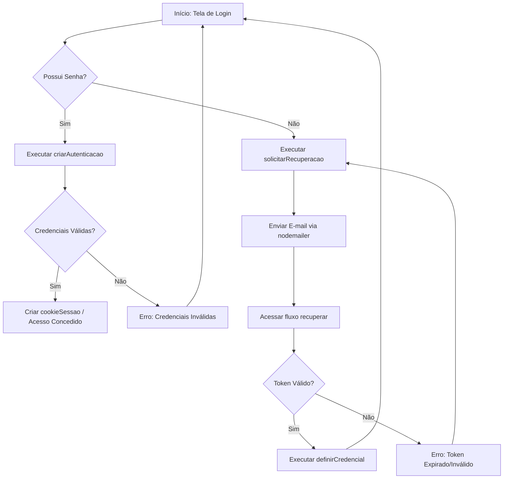
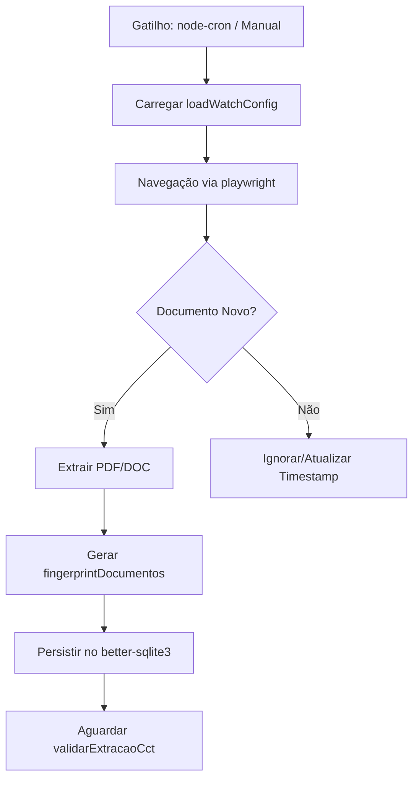
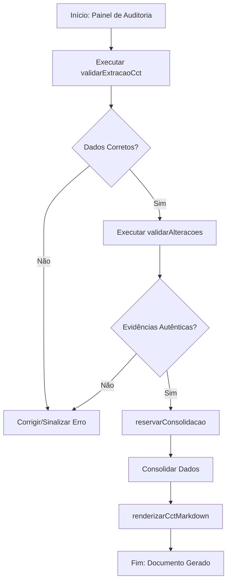

# User Flows & Interaction Diagrams — mte-mediador-monitor-unificado

## 1. User Personas & Actors

| Ator | Papel | Objetivos Principais | Permissões |
| :--- | :--- | :--- | :--- |
| **Administrador** | [INFERIDO POR IA — REQUER VALIDAÇÃO HUMANA] Gestor do Sistema | Configurar o sistema, gerenciar acessos e realizar bootstrap de contas. | Acesso total via `auth:bootstrap` e `exigirPermissao`. |
| **Operador de Cadastro** | [INFERIDO POR IA — REQUER VALIDAÇÃO HUMANA] Analista de Dados | Realizar a auditoria de cadastros e validar a extração de CCTs. | Executar `auditarCadastro` e `validarExtracaoCct`. |
| **Analista Jurídico/Sindicato** | [INFERIDO POR IA — REQUER VALIDAÇÃO HUMANA] Especialista em CCT | Validar alterações textuais em instrumentos coletivos e gerar documentos finais. | Executar `validarAlteracoes` e `renderizarCctMarkdown`. |
| **Usuário Final** | [INFERIDO POR IA — REQUER VALIDAÇÃO HUMANA] Cliente/Escritório | Acessar informações de monitoramento e gerenciar a própria conta. | Acesso limitado via `cookieSessao` e `exigirCadastroEscritorio`. |

## 2. Core User Flows

### Flow 1: Autenticação e Recuperação de Acesso
* **Gatilho:** Usuário tenta acessar o sistema ou esqueceu a senha.
* **Ator:** Usuário Final / Administrador.
* **Pré-condições:** Usuário deve possuir cadastro ativo ou e-mail válido vinculado.
* **Resultado esperado:** Acesso concedido ao sistema via sessão segura ou credenciais redefinidas.

* **Passos:**
  1. [Usuário tenta login] $\rightarrow$ Sistema valida via `criarAutenticacao`.
  2. [Se senha esquecida] $\rightarrow$ Usuário aciona `solicitarRecuperacao`.
  3. [Sistema] $\rightarrow$ Envia token via `nodemailer` e armazena `hashToken`.
  4. [Usuário] $\rightarrow$ Acessa link de `recuperar` com token.
  5. [Sistema] $\rightarrow$ Valida token e permite `definirCredencial`.
  6. [Usuário] $\rightarrow$ Define nova senha e realiza login.

* **Estados de UI cobertos:** [INFERIDO POR IA — REQUER VALIDAÇÃO HUMANA]
    * **Loading:** Durante a validação de hash de senha e envio de e-mail.
    * **Error:** Mensagens de "Usuário não encontrado" ou "Token inválido".
    * **Success:** Redirecionamento para o dashboard após `cookieSessao` criado.
* **Métricas instrumentadas neste fluxo:** [INFERIDO POR IA — REQUER VALIDAÇÃO HUMANA] Taxa de recuperação de senha e tempo médio de login.

### Flow 2: Monitoramento e Extração de CCTs
* **Gatilho:** Execução de rotina agendada ou disparo manual de reanálise.
* **Ator:** Sistema (via `node-cron`) / Administrador.
* **Pré-condições:** Configurações de monitoramento carregadas via `loadWatchConfig`.
* **Resultado esperado:** Documentos coletados, processados e disponíveis para auditoria.

* **Passos:**
  1. [Sistema] $\rightarrow$ Dispara `check:auto` ou `seed:auto` via `node-cron`.
  2. [Sistema] $\rightarrow$ Navega em fontes externas via `playwright`.
  3. [Sistema] $\rightarrow$ Extrai conteúdo de PDFs (`pdf-parse`) e DOCs (`word-extractor`).
  4. [Sistema] $\rightarrow$ Gera `fingerprintDocumentos` para evitar duplicidade.
  5. [Sistema] $\rightarrow$ Armazena dados brutos para posterior `validarExtracaoCct`.

* **Estados de UI cobertos:** [INFERIDO POR IA — REQUER VALIDAÇÃO HUMANA]
    * **Loading:** Indicador de progresso de coleta (se houver interface de monitoramento).
    * **Error:** Alerta de "Mudança de layout na fonte externa" (conforme risco de negócio).
    * **Empty:** Lista de documentos vazia para a fonte selecionada.
* **Métricas instrumentadas neste fluxo:** [INFERIDO POR IA — REQUER VALIDAÇÃO HUMANA] Volume de documentos extraídos por ciclo e taxa de erro de parsing.

### Flow 3: Auditoria e Consolidação de Dados
* **Gatilho:** Disponibilidade de novos dados extraídos ou necessidade de revisão.
* **Ator:** Operador de Cadastro / Analista Jurídico.
* **Pré-condições:** Documentos já extraídos e persistidos no banco.
* **Resultado esperado:** CCT consolidada, auditada e renderizada em Markdown.

* **Passos:**
  1. [Usuário] $\rightarrow$ Acessa painel de auditoria.
  2. [Usuário] $\rightarrow$ Executa `validarExtracaoCct` para conferir a fidelidade do texto.
  3. [Usuário] $\rightarrow$ Executa `validarAlteracoes` para aprovar modificações com evidências.
  4. [Sistema] $\rightarrow$ Bloqueia concorrência via `reservarConsolidacao`.
  5. [Sistema] $\rightarrow$ Processa a consolidação final.
  6. [Usuário] $\rightarrow$ Gera documento final via `renderizarCctMarkdown`.

* **Estados de UI cobertos:** [INFERIDO POR IA — REQUER VALIDAÇÃO HUMANA]
    * **Loading:** Processamento da consolidação de dados.
    * **Disabled:** Botão de consolidação desativado se outro usuário detiver a `reservarConsolidacao`.
    * **Success:** Visualização do Markdown renderizado.
* **Métricas instrumentadas neste fluxo:** [INFERIDO POR IA — REQUER VALIDAÇÃO HUMANA] Tempo médio de auditoria por documento.

## 3. Edge Cases & Error Flows

| Cenário | Tratamento na UI | Mensagem exibida |
| :--- | :--- | :--- |
| Sessão expirada durante auditoria | [INFERIDO POR IA] Redireciona para login via `lerCookieSessao` falhando. | "Sua sessão expirou. Por favor, faça login novamente." |
| Falha de extração de PDF/DOC | [INFERIDO POR IA] Marca o documento como "Erro de Extração" em `validarExtracaoCct`. | "Falha ao processar arquivo. Verifique a integridade do documento fonte." |
| Concorrência na consolidação | [INFERIDO POR IA] Bloqueia a ação via `reservarConsolidacao`. | "Este documento está sendo consolidado por outro usuário no momento." |
| Mudança de layout no site fonte | [INFERIDO POR IA] Alerta no log/painel após falha do `playwright`. | "Erro de coleta: a estrutura da fonte externa foi alterada." |

## 4. Cross-Flow Dependencies
* **Flow 3 $\rightarrow$ Flow 2:** A Auditoria e Consolidação só podem ser iniciadas após a conclusão da Extração de CCTs.
* **Flow 1 $\rightarrow$ Todos:** O acesso a qualquer funcionalidade de auditoria ou configuração exige a validação de sessão (`cookieSessao`) e permissões (`exigirPermissao`).
* **Migração $\rightarrow$ Flow 1:** O fluxo de login para usuários antigos depende da execução prévia do script `importar-legado` e da função `protegerLegado`.

## 5. Acessibilidade nos Fluxos
* **Navegação por teclado:** [INFERIDO POR IA — REQUER VALIDAÇÃO HUMANA] Ordem de tabulação sequencial nos formulários de login e tabelas de auditoria.
* **Leitores de tela:** [INFERIDO POR IA — REQUER VALIDAÇÃO HUMANA] Uso de labels claras para campos de CNPJ e botões de ação de consolidação.

## 6. Referências
* **Wireframes/Protótipos:** Não fornecidos no repositório.
* **Use Cases relacionados:** Não fornecidos no repositório.