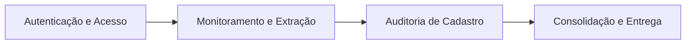

# Story Map & Slicing Strategy — mte-mediador-monitor-unificado

> Baseado na metodologia de *User Story Mapping* (Jeff Patton). O eixo horizontal representa a jornada do usuário; o eixo vertical representa a priorização por release/slice.

## 1. Backbone (Atividades do Usuário)
Autenticação e Acesso $\rightarrow$ Monitoramento e Extração $\rightarrow$ Auditoria de Cadastro $\rightarrow$ Consolidação e Entrega de CCT

## 2. Horizontal Axis (User Journey Steps)
| Etapa | Objetivo do Usuário | Tarefas Associadas |
| :--- | :--- | :--- |
| **Autenticação e Acesso** | Garantir acesso seguro ao sistema e recuperação de credenciais. | Login, Recuperação de Senha, Validação de Sessão/CSRF. |
| **Monitoramento e Extração** | Coletar automaticamente instrumentos coletivos de fontes externas. | Varredura de sites, Extração de PDF/DOC, Geração de Fingerprint. |
| **Auditoria de Cadastro** | Validar a identidade das empresas vinculadas aos documentos. | Consulta de CNPJ, Normalização de Dados, Migração de Legado. |
| **Consolidação e Entrega** | Transformar dados brutos em documentos auditados e renderizados. | Validação de Extração, Aprovação de Alterações, Renderização Markdown. |

## 3. Vertical Axis (MoSCoW Slicing)

### Slice 1: MVP (Must Have) — Release 1.0
* **Objetivo do slice:** Entregar a jornada ponta-a-ponta funcional mínima: do login à geração do documento Markdown, incluindo a migração de dados essenciais.
* **Stories:**
  - **[REQ-001]** — Autenticação Básica e Sessão — [Autenticação e Acesso]
  - **[REQ-002]** — Coleta Automatizada via Playwright — [Monitoramento e Extração]
  - **[REQ-003]** — Extração de Texto (PDF/DOC) — [Monitoramento e Extração]
  - **[REQ-004]** — Validação de CNPJ e Cadastro Básico — [Auditoria de Cadastro]
  - **[REQ-005]** — Migração de Dados Legados — [Auditoria de Cadastro]
  - **[REQ-006]** — Validação de Extração e Alterações — [Consolidação e Entrega]
  - **[REQ-007]** — Renderização de CCT em Markdown — [Consolidação e Entrega]

### Slice 2: Should Have — Release 1.1
* **Objetivo do slice:** Aumentar a resiliência do sistema, segurança de acesso e eficiência operacional.
* **Stories:**
  - **[REQ-008]** — Fluxo Completo de Recuperação de Senha via E-mail — [Autenticação e Acesso]
  - **[REQ-009]** — Controle de Concorrência via `reservarConsolidacao` — [Consolidação e Entrega]
  - **[REQ-010]** — Cache de Consultas de CNPJ para Performance — [Auditoria de Cadastro]
  - **[REQ-011]** — Alertas de Mudança de Layout em Fontes Externas — [Monitoramento e Extração]

### Slice 3: Could Have — Backlog
* **Objetivo do slice:** Refinamentos de UX e automações avançadas de auditoria.
* **Stories:**
  - **[REQ-012]** — Painel de Monitoramento de Status de Coleta em Tempo Real — [Monitoramento e Extração]
  - **[REQ-013]** — Auditoria de Cadastro Automatizada por Lotes — [Auditoria de Cadastro]
  - **[REQ-014]** — Histórico de Versões de CCTs Consolidadas — [Consolidação e Entrega]

### Won't Have (Neste Ciclo)
* **Auto-scaling Horizontal:** O projeto é definido como monolítico em nó único com `better-sqlite3`, tornando a escalabilidade horizontal fora de escopo técnico atual.
* **Interface de Gestão de SMTP:** A configuração permanecerá via variáveis de ambiente (`dotenv`).

## 4. Mapa Visual (Matriz Completa)
| | Autenticação e Acesso | Monitoramento e Extração | Auditoria de Cadastro | Consolidação e Entrega |
| :--- | :--- | :--- | :--- | :--- |
| **MVP** | [REQ-001] | [REQ-002], [REQ-003] | [REQ-004], [REQ-005] | [REQ-006], [REQ-007] |
| **Should** | [REQ-008] | [REQ-011] | [REQ-010] | [REQ-009] |
| **Could** | | [REQ-012] | [REQ-013] | [REQ-014] |

## 5. Critérios de Corte entre Releases
* **Corte MVP $\rightarrow$ Should:** O MVP é considerado "Pronto" quando um usuário consegue logar, o sistema coleta um documento, a empresa é vinculada via CNPJ e o Markdown final é gerado com sucesso.
* **Corte Should $\rightarrow$ Could:** O Release 1.1 é considerado "Pronto" quando a estabilidade de concorrência (`reservarConsolidacao`) e a recuperação de senha estão homologadas, eliminando a dependência de intervenção manual do administrador para resets de senha.

## 6. Riscos de Slicing
* **Risco de Segurança no MVP:** A complexidade ciclomática alta nas funções de autenticação (`criarAutenticacao`, `criarAcessoHttp`) pode introduzir vulnerabilidades no MVP. 
  * **Mitigação:** Priorizar a refatoração dessas funções como parte do desenvolvimento do [REQ-001].
* **Risco de Integridade no MVP:** A migração de legado [REQ-005] pode falhar em preservar vínculos históricos.
  * **Mitigação:** Utilização obrigatória do script `check:dry` para ensaios prévios antes da migração definitiva.
* **Risco de UX no MVP:** A ausência de alertas de layout [REQ-011] no MVP pode fazer com que o usuário perceba a falta de novos documentos como um erro do sistema.
  * **Mitigação:** [INFERIDO POR IA — REQUER VALIDAÇÃO HUMANA] Implementar logs simples de erro que possam ser consultados pelo administrador via CLI enquanto o painel de alertas não é desenvolvido.