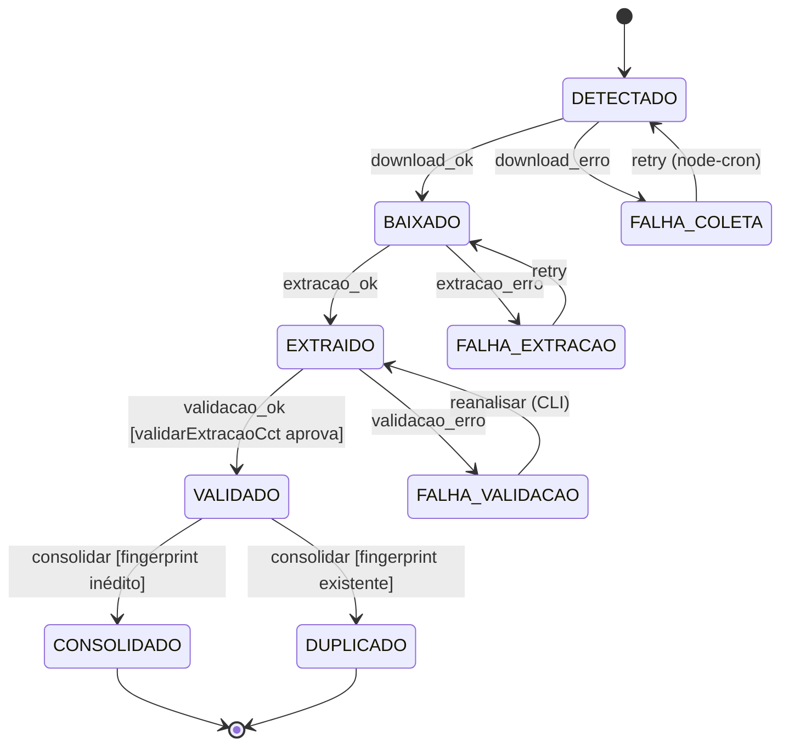
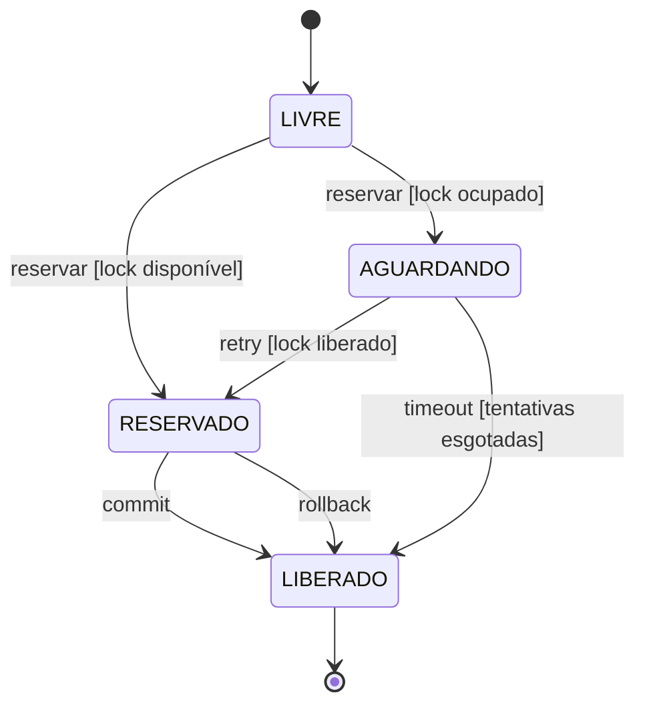
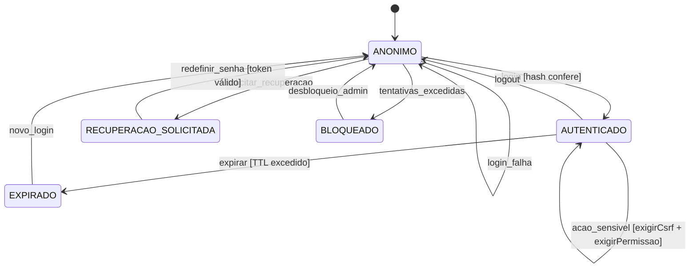
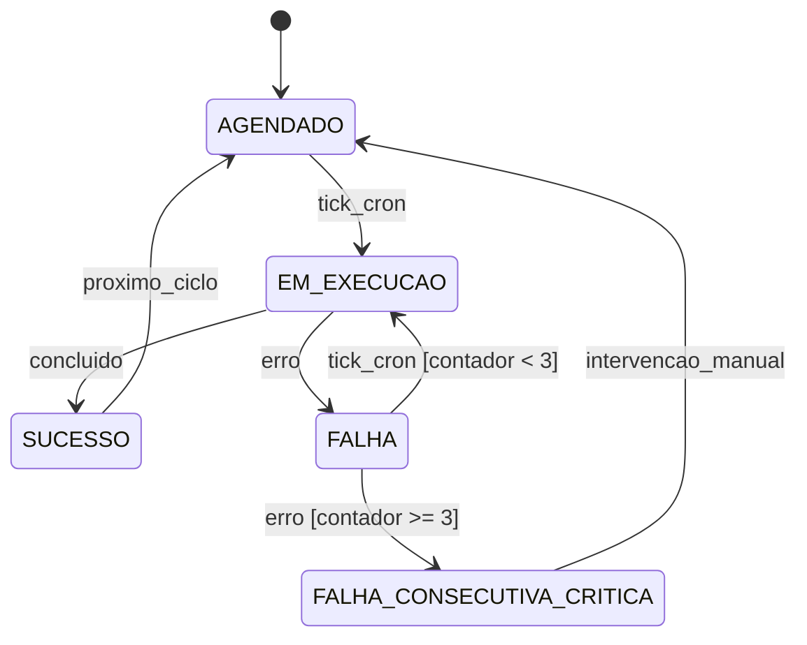

# Formal State Machine (FSM) Specifications — mte-mediador-monitor-unificado

> **Versão:** 1.0 · **Status:** Draft · **Owner:** Engenharia/Arquitetura
> **Artefatos-fonte:** System Architecture Document (SAD), Non-Functional Requirements (NFR)
>
> **Nota de proveniência:** O diagnóstico determinístico **não detectou tabelas/colunas de estado no schema** (não há `schema.sql` versionado; o schema é criado ad-hoc por `seed`, `importar-legado` e `autenticacao.ts`) nem rotas/handlers formais. Portanto, **todas as máquinas de estado abaixo são inferidas** dos ciclos de vida descritos no SAD e no NFR (funções reais citadas: `fingerprintDocumentos`, `validarExtracaoCct`, `reservarConsolidacao`, `criarConsultaCnpj`, `criarAutenticacao`, `hashToken`, `exigirCsrf`, `exigirPermissao`). Cada FSM carrega o rótulo **[INFERIDO POR IA — REQUER VALIDAÇÃO HUMANA]** e suas premissas devem ser confirmadas contra o código antes de virar contrato.

---

## 1. Core State Machine: Documento CCT (Ciclo de Vida de Coleta → Consolidação)

**[INFERIDO POR IA — REQUER VALIDAÇÃO HUMANA]**

### Purpose
Representa o ciclo de vida de uma Convenção Coletiva de Trabalho (CCT) ou aditivo desde sua detecção pelo scraper (`playwright`) até sua consolidação na base SQLite. É modelado como FSM porque o SAD descreve etapas sequenciais com pontos de falha distintos (coleta, extração, validação, consolidação) e requisitos explícitos de idempotência (`fingerprintDocumentos`, NFR-A04) e auditabilidade (`validarExtracaoCct`, NFR-C02).

**Premissas adotadas:**
- O pipeline segue a ordem: scraping → download do arquivo → extração de texto (`pdf-parse`/`word-extractor`) → validação (`validarExtracaoCct`) → consolidação (`reservarConsolidacao`).
- `fingerprintDocumentos` atua como guarda de idempotência antes da consolidação.
- Não há estado de "publicação" ou "revisão humana" detectado no código — a consolidação é o destino final.

### Valid States
| Estado | Descrição | É estado final? |
| :--- | :--- | :--- |
| `DETECTADO` | Documento encontrado pelo scraper no portal de origem; metadados (URL, fonte, data) registrados. | Não |
| `BAIXADO` | Arquivo PDF/Word obtido e armazenado em diretório temporário local. | Não |
| `EXTRAIDO` | Texto bruto extraído com sucesso via `pdf-parse` ou `word-extractor`. | Não |
| `VALIDADO` | Extração passou por `validarExtracaoCct` (schema `zod`); campos estruturados íntegros e auditáveis. | Não |
| `CONSOLIDADO` | Registro persistido na base SQLite via `reservarConsolidacao`; fingerprint registrado. | Sim |
| `DUPLICADO` | Fingerprint já existente na base (`fingerprintDocumentos`); documento descartado sem escrita. | Sim |
| `FALHA_COLETA` | Erro de scraping/download (timeout `playwright`, mudança de layout, rede). | Não (recuperável) |
| `FALHA_EXTRACAO` | `pdf-parse`/`word-extractor` falhou ou retornou texto vazio/corrompido. | Não (recuperável) |
| `FALHA_VALIDACAO` | `validarExtracaoCct` rejeitou o conteúdo (schema inválido, campos ausentes). | Não (recuperável via `reanalisar`) |

### Transition Matrix
| Estado Atual | Evento | Próximo Estado | Guarda (Condição) | Side Effects |
| :--- | :--- | :--- | :--- | :--- |
| `DETECTADO` | `download_ok` | `BAIXADO` | Arquivo gravado em disco temporário sem erro de I/O | Registra caminho temporário |
| `DETECTADO` | `download_erro` | `FALHA_COLETA` | Exceção `playwright`/rede | Notificação via `nodemailer` (alerta de quebra de scraping, NFR-O02) |
| `BAIXADO` | `extracao_ok` | `EXTRAIDO` | Parser retorna texto não-vazio | Remove/retém arquivo temporário |
| `BAIXADO` | `extracao_erro` | `FALHA_EXTRACAO` | Exceção em `pdf-parse`/`word-extractor` | Log estruturado do erro (NFR-O01) |
| `EXTRAIDO` | `validacao_ok` | `VALIDADO` | `validarExtracaoCct` aprova schema `zod` | Nenhum (validação não mascara erros, NFR-C02) |
| `EXTRAIDO` | `validacao_erro` | `FALHA_VALIDACAO` | Schema inválido | Erro registrado com payload para auditoria |
| `VALIDADO` | `consolidar` | `CONSOLIDADO` | `fingerprintDocumentos` inédito **E** `reservarConsolidacao` obtém lock de escrita | INSERT no SQLite em transação; registra fingerprint |
| `VALIDADO` | `consolidar` | `DUPLICADO` | `fingerprintDocumentos` já existe na base | Nenhuma escrita (idempotência, NFR-A04) |
| `FALHA_COLETA` | `retry` | `DETECTADO` | Próxima execução do `node-cron` (`check:auto`) | Contador de tentativas incrementado |
| `FALHA_EXTRACAO` | `retry` | `BAIXADO` | Arquivo temporário ainda disponível ou re-download | — |
| `FALHA_VALIDACAO` | `reanalisar` | `EXTRAIDO` | Script CLI `reanalisar` executado manualmente | Marca registro para reprocessamento |

### Invalid Transitions (Explicitamente Proibidas)
| De | Evento | Para | Motivo da Proibição |
| :--- | :--- | :--- | :--- |
| `CONSOLIDADO` | qualquer | — | Estado terminal: a base consolidada é a fonte de verdade; alterações exigem novo documento/aditivo, não mutação in-place. |
| `DUPLICADO` | `consolidar` | `CONSOLIDADO` | Violaria a idempotência por fingerprint (NFR-A04) e criaria duplicidade na base. |
| `DETECTADO` | `consolidar` | `CONSOLIDADO` | Pular extração/validação elimina a auditabilidade exigida por NFR-C02. |
| `EXTRAIDO` | `consolidar` | `CONSOLIDADO` | Consolidação sem `validarExtracaoCct` é proibida (NFR-C02: validação não pode ser contornada). |
| `VALIDADO` | `extracao_ok` | `EXTRAIDO` | Regressão de estado sem evento de reprocessamento (`reanalisar`) corromperia a trilha de auditoria. |

### Diagram

---

## 2. State Machine: Reserva de Consolidação (Lock de Escrita SQLite)

**[INFERIDO POR IA — REQUER VALIDAÇÃO HUMANA]**

### Purpose
Modela o mecanismo de serialização de escritas `reservarConsolidacao`, que protege o SQLite contra *single-writer lock contention* (NFR-P02, NFR-S03). É uma FSM curta, mas crítica para integridade.

**Premissas adotadas:**
- Existe uma tabela/registro de locks no SQLite (mencionada no SAD como "tabela de locks").
- Retry com backoff em escritas é exigido por NFR-P02, mas o SAD marca a implementação como **pendente** — as transições de retry abaixo são o comportamento-alvo.

### Valid States
| Estado | Descrição | É estado final? |
| :--- | :--- | :--- |
| `LIVRE` | Nenhuma consolidação em andamento; lock disponível. | Não |
| `RESERVADO` | Lock adquirido por uma rotina de consolidação; escrita em curso. | Não |
| `AGUARDANDO` | Requisição de escrita enfileirada aguardando liberação (retry/backoff). | Não |
| `LIBERADO` | Escrita concluída (commit) ou abortada (rollback); lock devolvido. | Sim (transitório, retorna a `LIVRE`) |

### Transition Matrix
| Estado Atual | Evento | Próximo Estado | Guarda (Condição) | Side Effects |
| :--- | :--- | :--- | :--- | :--- |
| `LIVRE` | `reservar` | `RESERVADO` | Nenhum lock ativo na tabela de locks | Registra lock com timestamp e identificador da rotina |
| `LIVRE` | `reservar` | `AGUARDANDO` | Lock ativo pertence a outra rotina | Agenda retry com backoff exponencial (NFR-P02) |
| `AGUARDANDO` | `retry` | `RESERVADO` | Lock anterior liberado dentro do timeout | Adquire lock |
| `AGUARDANDO` | `timeout` | `LIBERADO` | Tentativas esgotadas | Erro propagado; documento permanece em `VALIDADO` para próxima execução |
| `RESERVADO` | `commit` | `LIBERADO` | Transação SQLite concluída | Remove lock; documento → `CONSOLIDADO` |
| `RESERVADO` | `rollback` | `LIBERADO` | Exceção durante escrita | Remove lock; documento permanece em `VALIDADO` |

### Invalid Transitions
| De | Evento | Para | Motivo da Proibição |
| :--- | :--- | :--- | :--- |
| `RESERVADO` | `reservar` | `RESERVADO` | Reentrância no mesmo lock causaria deadlock ou escrita concorrente (NFR-S03). |
| `AGUARDANDO` | `commit` | `LIBERADO` | Não se pode commitar sem ter adquirido o lock. |

### Diagram

---

## 3. State Machine: Sessão de Usuário / Acesso Administrativo

**[INFERIDO POR IA — REQUER VALIDAÇÃO HUMANA]**

### Purpose
Ciclo de vida de autenticação no servidor HTTP próprio (`auth-http.ts`), baseado em `criarAutenticacao`, `criarHashSenha`, `hashToken`, `exigirCsrf`, `exigirPermissao` e nos scripts `auth:bootstrap` / `auth:redefinir` (NFR-SEC01/02/03).

**Premissas adotadas:**
- Sessões e tokens de recuperação são persistidos no SQLite (tabelas criadas por `autenticacao.ts`, conforme SAD §5).
- Tokens de recuperação de senha têm expiração (NFR-SEC03).

### Valid States
| Estado | Descrição | É estado final? |
| :--- | :--- | :--- |
| `ANONIMO` | Requisição sem sessão válida. | Não |
| `AUTENTICADO` | Login validado contra `criarHashSenha`; sessão ativa em SQLite. | Não |
| `RECUPERACAO_SOLICITADA` | Token de recuperação gerado (`hashToken`) e pendente de uso. | Não |
| `EXPIRADO` | Sessão ou token de recuperação além do prazo de validade. | Sim (transitório → `ANONIMO`) |
| `BLOQUEADO` | [INFERIDO] Conta bloqueada por tentativas excessivas ou ação administrativa. | Não |

### Transition Matrix
| Estado Atual | Evento | Próximo Estado | Guarda (Condição) | Side Effects |
| :--- | :--- | :--- | :--- | :--- |
| `ANONIMO` | `login` | `AUTENTICADO` | Hash da senha confere (`criarHashSenha`) | Cria sessão no SQLite; cookie emitido |
| `ANONIMO` | `login_falha` | `ANONIMO` | Hash não confere | [INFERIDO] Incrementa contador de tentativas |
| `ANONIMO` | `solicitar_recuperacao` | `RECUPERACAO_SOLICITADA` | Usuário existe | Gera `hashToken` com expiração; envia e-mail via `nodemailer` |
| `RECUPERACAO_SOLICITADA` | `redefinir_senha` | `ANONIMO` | Token válido e não expirado | Invalida token; atualiza hash da senha; invalida sessões antigas |
| `AUTENTICADO` | `logout` | `ANONIMO` | Sessão válida | Remove sessão do SQLite |
| `AUTENTICADO` | `expirar` | `EXPIRADO` | TTL da sessão excedido | Sessão marcada inválida |
| `AUTENTICADO` | `acao_sensivel` | `AUTENTICADO` | `exigirCsrf` **E** `exigirPermissao` aprovam | Executa ação autorizada |
| `ANONIMO` | `tentativas_excedidas` | `BLOQUEADO` | [INFERIDO] Contador acima do limite | Alerta ao administrador |
| `BLOQUEADO` | `desbloqueio_admin` | `ANONIMO` | Ação de usuário com permissão admin | Zera contador |

### Invalid Transitions
| De | Evento | Para | Motivo da Proibição |
| :--- | :--- | :--- | :--- |
| `ANONIMO` | `acao_sensivel` | `AUTENTICADO` | Bypass de autenticação; `exigirPermissao` deve rejeitar (NFR-SEC02). |
| `EXPIRADO` | `acao_sensivel` | `AUTENTICADO` | Sessão expirada não pode ser ressuscitada sem novo login. |
| `RECUPERACAO_SOLICITADA` | `redefinir_senha` (token expirado) | `ANONIMO` | Token expirado deve ser rejeitado (NFR-SEC03); exige nova solicitação. |

### Diagram

---

## 4. State Machine: Job de Coleta Agendado (`node-cron` / `check:auto`)

**[INFERIDO POR IA — REQUER VALIDAÇÃO HUMANA]**

### Purpose
Ciclo de vida de cada execução da rotina agendada de monitoramento (NFR-A01: uptime ≥ 99% das rotinas). Relevante para alertas de falhas consecutivas de scraping (NFR-O02).

### Valid States
| Estado | Descrição | É estado final? |
| :--- | :--- | :--- |
| `AGENDADO` | Aguardando disparo do `node-cron`. | Não |
| `EM_EXECUCAO` | Rotina rodando (scraping + pipeline de documentos). | Não |
| `SUCESSO` | Execução concluída sem erros fatais. | Sim |
| `FALHA` | Execução abortada por erro (browser, rede, banco). | Sim |
| `FALHA_CONSECUTIVA_CRITICA` | ≥ 3 falhas consecutivas (limiar de alerta do SAD §10). | Sim (até intervenção) |

### Transition Matrix
| Estado Atual | Evento | Próximo Estado | Guarda (Condição) | Side Effects |
| :--- | :--- | :--- | :--- | :--- |
| `AGENDADO` | `tick_cron` | `EM_EXECUCAO` | Nenhuma execução anterior em andamento | Timestamp de início registrado |
| `EM_EXECUCAO` | `concluido` | `SUCESSO` | Pipeline processou fontes sem exceção fatal | Zera contador de falhas consecutivas |
| `EM_EXECUCAO` | `erro` | `FALHA` | Exceção não tratada / timeout | Incrementa contador; log estruturado |
| `FALHA` | `tick_cron` | `EM_EXECUCAO` | Contador < 3 | Nova tentativa automática |
| `FALHA` | `erro` (3ª vez) | `FALHA_CONSECUTIVA_CRITICA` | Contador ≥ 3 | **Alerta obrigatório** via `nodemailer` (NFR-O02) |
| `FALHA_CONSECUTIVA_CRITICA` | `intervencao_manual` | `AGENDADO` | Operador corrige causa (ex: seletor do portal) | Contador zerado |

### Invalid Transitions
| De | Evento | Para | Motivo da Proibição |
| :--- | :--- | :--- | :--- |
| `EM_EXECUCAO` | `tick_cron` | `EM_EXECUCAO` | Sobreposição de execuções corromperia o lock de consolidação (NFR-S03); o cron deve pular ticks concorrentes. |
| `SUCESSO` | `erro` | `FALHA` | Estado final da execução; erros posteriores pertencem a uma nova execução. |

### Diagram

---

## 5. Idempotency & Concorrência (Transversal)

* **Estratégia de lock:** *Pessimistic locking* via `reservarConsolidacao` + tabela de locks no SQLite (SAD §3). O SQLite já serializa escritores nativamente (single-writer); a reserva evita filas longas e timeouts (NFR-P02/S03).
* **Idempotência de consolidação:** `fingerprintDocumentos` (NFR-A04) — reexecutar o pipeline sobre o mesmo documento é **no-op** (transição `VALIDADO → DUPLICADO`, sem escrita).
* **Idempotência de retry de jobs:** reprocessamento após `FALHA_*` é seguro porque nenhum estado intermediário grava na base consolidada.
* **Race conditions conhecidas:**
  1. Dois ticks de cron sobrepostos disputando o lock — mitigado pela guarda "nenhuma execução em andamento" (FSM §4).
  2. Cache de CNPJ em memória (`criarConsultaCnpj`) não é compartilhado nem sobrevive a restart — aceitável para nó único (NFR-S02).
  3. Sessão expirando durante requisição sensível — `exigirCsrf`/`exigirPermissao` devem revalidar a sessão a cada request.

## 6. Persistência do Estado

* **Onde:** Arquivo único `.sqlite` via `better-sqlite3` (SQL cru, sem ORM). **Não há schema versionado detectado** — as colunas de estado exatas (ex: `status` em tabela de documentos, `expires_at` em sessões/tokens) **precisam ser confirmadas no código** [INFERIDO POR IA — REQUER VALIDAÇÃO HUMANA].
* **Auditoria de transições:** Não há tabela de histórico de transições detectada. Recomenda-se (gap): registrar `{entidade, estado_anterior, estado_novo, evento, ator, timestamp}` para atender NFR-C02 (auditabilidade) e NFR-O01 (logs estruturados).
* **Backup/recuperação:** estado persistido é protegido por cópia do arquivo `.sqlite` (RTO ≤ 4h, RPO ≤ 24h — NFR-A02/A03).

## 7. Error & Recovery States

| Estado de Erro | Origem | Como se recupera |
| :--- | :--- | :--- |
| `FALHA_COLETA` | Timeout/quebra de layout no `playwright` | Retry automático no próximo tick do cron; após 3 falhas, alerta por e-mail (NFR-O02) |
| `FALHA_EXTRACAO` | `pdf-parse`/`word-extractor` em arquivo corrompido | Retry; se persistente, re-download do documento |
| `FALHA_VALIDACAO` | `validarExtracaoCct` rejeita schema | Script CLI `reanalisar` após correção do parser |
| Timeout de lock (`AGUARDANDO`) | Contenção de escrita SQLite | Documento permanece `VALIDADO`; consolidação re-tentada no ciclo seguinte (NFR-P02) |
| Sessão `EXPIRADA` | TTL excedido | Novo login; nenhuma ação sensível permitida |
| Corrupção do `.sqlite` | Falha de disco/processos | Restauração de backup (RTO ≤ 4h — NFR-A02) |

## 8. Testes Obrigatórios

- [ ] Todas as transições válidas das 4 FSMs cobertas por testes `vitest` (alinhado a NFR-M02: `test:smoke`, `test:review`, `test:auth-ui`).
- [ ] Transições inválidas rejeitadas: consolidação sem validação; ação sensível sem `exigirCsrf`/`exigirPermissao`; redefinição de senha com token expirado.
- [ ] Idempotência: executar pipeline 2× sobre o mesmo documento → segunda execução resulta em `DUPLICADO`, zero escritas adicionais (`fingerprintDocumentos`).
- [ ] Concorrência: duas consolidações simultâneas → exatamente uma adquire `RESERVADO`; a outra aguarda ou falha com timeout controlado.
- [ ] Estados finais imutáveis: `CONSOLIDADO` e `DUPLICADO` não aceitam nenhuma transição de saída.
- [ ] Alerta disparado na 3ª falha consecutiva de scraping (NFR-O02).
- [ ] **Validação humana pendente:** confirmar no código os nomes reais das colunas de estado, a existência da tabela de locks e os TTLs de sessão/token antes de promover estas FSMs a contrato.