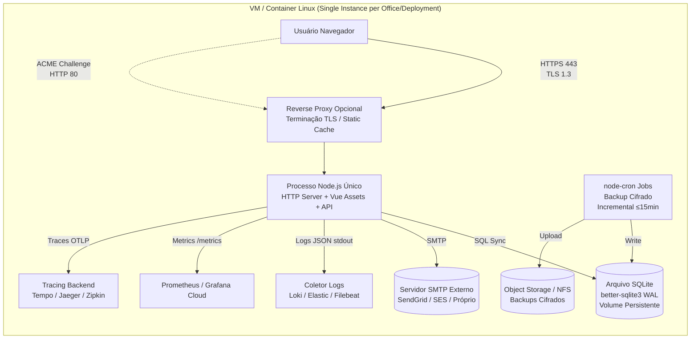

# System Architecture Document (SAD) — dist-historico (Sistema de Histórico e Gestão Documental)

> **Versão:** 1.0 · **Owner:** Arquitetura/Eng Lead · **Status:** Draft
> **ADRs relacionadas:** [Pendentes — a serem formalizadas conforme decisões de arquitetura]

## 1. Overview & Goals

O **dist-historico** é um sistema de histórico e gestão documental multi-tenant (escritórios/tenants isolados) construído como uma aplicação **monolítica server-side** em **Node.js + TypeScript** com frontend **Vue 3** servido pelo mesmo processo. O banco de dados operacional é **SQLite embarcado (better-sqlite3)** em modo WAL, acessado via **SQL cru (sem ORM)**. A aplicação roda em instância única (single-process) por deployment, sem clustering, load balancer ou replicação nativa.

**Objetivos arquiteturais principais** (derivados dos NFRs):
- **Isolamento estrito de tenant**: nenhuma query cross-tenant em operações normais; transações por escritório (`withPostgresOfficeTransaction` / equivalente SQLite).
- **Latência previsível**: p95 ≤ 200 ms (leitura) / ≤ 300 ms (escrita) em base representativa (≈10k clientes, 50k docs).
- **Confiabilidade com SPOF assumido**: RTO ≤ 1 h, RPO ≤ 15 min via backups cifrados automatizados (`node-cron`) e scripts de recuperação testados.
- **Segurança por design**: SQLite cifrado em repouso, TLS 1.3 em trânsito, validação Zod em todos endpoints, auditoria imutável (insert-only), menor privilégio no runtime do banco.
- **Observabilidade como meta a implementar**: logs JSON estruturados, `/health`, `/metrics` (Prometheus), tracing OpenTelemetry — **nenhuma biblioteca detectada hoje**.
- **Custo operacional baixo**: ≤ USD 50/mês por escritório ativo (VM 2 vCPU / 4 GB RAM / 50 GB SSD), zero licenças proprietárias.

## 2. Tech Stack Justification

| Camada | Tecnologia Escolhida | Alternativas Consideradas | Justificativa Resumida |
| :--- | :--- | :--- | :--- |
| Language/Runtime | **Node.js ≥ 20 LTS + TypeScript 5.6** | Deno, Bun | Ecossistema maduro, suporte nativo a `better-sqlite3`, tooling TypeScript (`vue-tsc`, `tsx`) já configurado. |
| Framework Web/Servidor | **Nenhum detectado (HTTP server nativo ou a definir)** | Express, Fastify, Hono, uWebSockets.js | `package.json` não lista framework web; decisão pendente — **requer escolha explícita da engenharia**. |
| Frontend Framework | **Vue 3.5 + Vite 6.4** | React, Svelte | Já presente nas dependências; build estático servido pelo mesmo processo Node.js (NFR-PO04). |
| Banco de Dados (Operacional) | **better-sqlite3 11.5 (SQLite em modo WAL)** | PostgreSQL (pg 8.23 presente mas não operacional), MySQL | SQLite embarcado elimina dependência externa, simplifica deploy/backup, atende escala alvo (≤50 users/tenant, single-writer). |
| ORM / Query Builder | **SQL cru (sem ORM)** | Prisma, Drizzle, Kysely, TypeORM | NFR exige controle fino de transações, locks e migrações atômicas; SQL cru evita overhead e mapeamento implícito. |
| Validação de Entrada | **Zod 3.23** | Joi, Yup, class-validator | Schema-first, TypeScript-native, já em `dependencies`. |
| Extração de Documentos | **pdf-parse 1.1 + word-extractor 1.0** | pdf.js, mammoth, unpdf | Requisitos NFR-P04 (≤2s/doc até 10 MB); bibliotecas leves e sem dependências nativas pesadas. |
| Geração de PDF Relatórios | **Playwright 1.48 (headless Chromium)** | Puppeteer, pdfkit, @react-pdf/renderer | Renderização fiel de HTML/CSS complexo; já em deps para testes E2E. |
| E-mail / Notificações | **Nodemailer 10.0** | SendGrid SDK, AWS SES SDK | SMTP genérico, compatível com qualquer provedor (NFR-CO03). |
| Agendamento / Jobs | **node-cron 4.2** | BullMQ, pg-boss, croner | Leve, roda no mesmo event loop; adequado para backups incrementais (NFR-A03). |
| Testes | **Vitest 2.1 (unit/integration) + Playwright 1.48 (E2E)** | Jest, Cypress | Vitest nativo Vite/TS; Playwright já presente para NFR-PO01. |
| Build / Dev Server | **Vite 6.4 + @vitejs/plugin-vue 5.2** | Webpack, Rsbuild | Padrão Vue 3; HMR rápido, build otimizado. |
| Variáveis de Ambiente | **dotenv 16.4** | — | Carregamento `.env` padrão; segredos não comitados (NFR-SEC01). |
| Sanitização HTML | **html-entities 2.6** | DOMPurify (server), sanitize-html | Escape de saída para relatórios HTML/PDF (NFR-SEC06, BR-11). |
| Observabilidade | **Nenhuma biblioteca detectada** | Pino/Winston + OpenTelemetry JS + Prometheus client | **Meta a implementar** (NFR-O01..O06) — marcado como `[INFERIDO POR IA — REQUER VALIDAÇÃO HUMANA]`. |
| Empacotamento Desktop | **Não aplicável (sem Tauri/Electron)** | Tauri, Electron | `src-tauri/Cargo.toml` não existe; deploy alvo é VM/container Linux (NFR-PO02, PO03). |

> **Nota:** A dependência `pg` (PostgreSQL client) existe no `package.json` mas **não é o motor operacional** — o NFR-S04 e o glossário citam rotinas "Postgres" para migração/backup; a convivência `better-sqlite3` + `pg` **precisa ser confirmada com a engenharia** antes de dimensionar capacidade.

## 3. High-Level Architecture

A aplicação é um **monolito server-side único** que expõe uma API HTTP (rotas a definir) e serve o frontend Vue 3 (assets estáticos do `build:frontend`). Todos os componentes rodam no mesmo processo Node.js (single-threaded event loop). O SQLite (`better-sqlite3`) reside em arquivo local no volume persistente da VM/container.

### Componentes

| Componente | Responsabilidade | Tecnologia | Escala Independente? |
| :--- | :--- | :--- | :--- |
| **HTTP Server** (a definir) | Roteamento, middleware (auth, validação Zod, CORS, TLS), serve static assets Vue | Node.js nativo / Express / Fastify / Hono **[INFERIDO POR IA — REQUER VALIDAÇÃO HUMANA]** | Não (single process) |
| **Domain Services** (Camada de Negócio) | Casos de uso: clientes, contatos, documentos, indexação, vínculos, relatórios, autenticação, auditoria | TypeScript (puro, sem framework) | Não |
| **Data Access Layer** | SQL cru parametrizado, transações WAL, migrações atômicas, isolamento por `officeId` | `better-sqlite3` (sync API) | Não |
| **Document Processing** | Extração de cabeçalho (PDF/DOCX), hash SHA-256 (`hashBytes`), validação de integridade | `pdf-parse`, `word-extractor`, `crypto` (Node) | Não |
| **Report Generation** | Render HTML → PDF via headless Chromium (Playwright) | `playwright` | Não |
| **Auth & Security** | Hash de credenciais, tokens de recuperação (não em claro), MFA futuro, menor privilégio runtime | `crypto` (Node), Zod | Não |
| **Scheduler / Jobs** | Backups incrementais cifrados, agendamento `node-cron` | `node-cron`, scripts `backup:*`, `postgres:*` | Não |
| **Frontend (Vue 3 App)** | Dashboard, listas, detalhes, formulários, relatórios — servido como SPA estática | Vue 3, Vite, CSS nativo | Não (assets servidos pelo HTTP Server) |
| **Observability Stack** (a implementar) | Logs JSON, `/health`, `/metrics` (Prometheus), tracing OpenTelemetry | Pino/Winston, `@opentelemetry/sdk-node`, `prom-client` **[INFERIDO POR IA — REQUER VALIDAÇÃO HUMANA]** | Não |

> **Diagrama de containers (C4)** mantido em `[[uml-diagrams]]` — não duplicado aqui.

## 4. Architectural Style & Patterns

* **Estilo:** **Monolito modular** (single-process Node.js + SQLite embarcado + Vue 3 SPA). Não há microsserviços, serverless, event-driven distribuído ou sidecars.
* **Padrões aplicados:**
  - **Repository Pattern (implícito)**: Data Access Layer isola SQL cru dos Domain Services.
  - **Transaction Script**: Operações de escrita encapsuladas em transações SQLite atômicas (`db.transaction()`).
  - **Tenant Isolation Middleware**: Todo handler resolve `officeId` e injeta no escopo da transação (`withPostgresOfficeTransaction` / equivalente SQLite).
  - **Immutable Audit Log**: Tabela `auditoria` insert-only; runtime account sem UPDATE/DELETE (NFR-C04, NFR-SEC05).
  - **Validation First**: Zod schemas em boundary de entrada (HTTP handlers) — reject 400 early.
  - **Output Encoding**: `html-entities` / `escaparHtml` em todo dado renderizado em HTML/PDF (NFR-SEC06, BR-11).
* **Comunicação entre componentes:** **Síncrona, in-process** (function calls). Não há mensageria, filas, gRPC ou REST interno. Jobs agendados (`node-cron`) rodam no mesmo event loop.

## 5. Data Modeling

* **Motor:** SQLite (`better-sqlite3`) em **modo WAL** (Write-Ahead Logging) para concorrência leitura/escrita.
* **Particionamento/Sharding:** **Não aplicável** — isolamento de tenant via coluna `office_id` + transações escopadas; single file DB por instância.
* **Migração de Schema:** Scripts versionados (`db:migrate`, `migrarCadastros`, `migrarAutenticacao`) executados em **transação atômica** com rollback automático em falha (NFR-A05, BR-17). Ver `[[db-migration-spec]]`.
* **Modelo Conceitual:** Entidades (Cliente, Contato, Documento, Vínculo, Auditoria, Escritório, Usuário) definidas em `[[db-domain-model]]`.
* **Contrato Físico (DDL):** Tabelas, colunas, constraints, índices em `[[db-schema-spec]]` — **nenhuma tabela detectada no schema atual** (workspace vazio ou não escaneado).
* **Integridade de Documentos:** `hashBytes` (SHA-256) calculado no `indexarMetaDocumento` e verificado no `lerDocumentoBytes` (NFR-C03, BR-08).

## 6. Integration Boundaries & APIs

| Integração | Tipo | Direção | Contrato | Criticidade |
| :--- | :--- | :--- | :--- | :--- |
| **SMTP Server** (SendGrid, AWS SES, etc.) | SMTP (Nodemailer) | Outbound | Credenciais via `.env` (NFR-SEC01) | Média (notificações, recuperação de acesso) |
| **Navegador do Usuário** | HTTP/HTTPS (REST + SPA) | Inbound | OpenAPI 3.1 (`openapi.yaml` a manter) — NFR-M04 | Alta |
| **Sistema de Arquivos (Volume Persistente)** | Local FS | Read/Write | Arquivo SQLite + backups cifrados | Crítica |
| **Certificados TLS** | Arquivos PEM/CRT/KEY | Read | `ui:https`, `test:https-local` scripts | Crítica (NFR-SEC02) |
| **Coletor de Observabilidade Externo** (Prometheus/Grafana, Loki, Tempo) | HTTP (OTLP, Prometheus remote write) | Outbound | `/metrics`, logs JSON stdout, traces OTLP **[INFERIDO POR IA — REQUER VALIDAÇÃO HUMANA]** | Alta (NFR-O01..O06) |

> **Nenhuma outra integração externa detectada** (pagamentos, ERPs, identity providers, etc.).

## 7. Scalability & Performance Strategy

* **Estratégia de escala:** **Vertical only** (NFR-S03). Aumentar CPU/RAM da VM/container. **Não há suporte a:** auto-scaling horizontal, clustering Node.js (`cluster` module), replicação multi-região, read replicas SQLite.
* **Limite de concorrência:** ≤ 50 usuários concorrentes por escritório (NFR-S01) — degradado ≤ 20% vs. single-user, limitado pelo **single-writer lock do SQLite (WAL)**.
* **Throughput alvo:** 30 req/s leitura / 10 req/s escrita por instância (NFR-S02).
* **Pontos de gargalo conhecidos:**
  1. **SQLite write lock** — serialização de escritas; `sqlite_write_lock_wait_seconds` monitorado (NFR-O03, NFR-O05).
  2. **Geração de PDF (Playwright)** — CPU-intensive, headless Chromium; limitar concorrência via fila interna ou semáforo.
  3. **Extração de documentos grandes** (≤10 MB) — `pdf-parse`/`word-extractor` síncronos; considerar `worker_threads` se necessário.
  4. **Event loop blocking** — SQL cru síncrono (`better-sqlite3` é sync); queries longas travam loop.
* **Estratégia de cache:** **Nenhuma camada de cache detectada/implementada**. Candidatos futuros (marcados como inferidos):
  - **In-memory LRU** para consultas de leitura frequentes (listagem clientes, contatos) — TTL curto, invalidação em escrita do mesmo `officeId`.
  - **HTTP cache headers** (ETag, Cache-Control) para assets estáticos Vue e respostas GET idempotentes.
  - **SQLite page cache** (`PRAGMA cache_size`) — tuning via pragma.
  > **[INFERIDO POR IA — REQUER VALIDAÇÃO HUMANA]**

## 8. Reliability & Fault Tolerance

* **Single Points of Failure identificados:**
  1. **Instância única do processo Node.js** — crash = downtime total.
  2. **Arquivo SQLite local** — corrupção/disco cheio = perda de disponibilidade.
  3. **Disco/volume persistente** — falha de hardware = perda de dados (mitigado por backup cifrado).
  4. **Certificados TLS** — expiração = HTTPS quebrado.
* **Estratégias de resiliência (a implementar / parciais):**
  - **Retry com backoff exponencial** em operações de escrita (lock SQLite) — max 3 tentativas, jitter.
  - **Circuit Breaker** para chamadas SMTP externas (Nodemailer) — evitar cascade failure.
  - **Timeouts** em todos I/O: HTTP request (ex: 30s), SQLite busy_timeout (ex: 5000ms), Playwright (ex: 60s).
  - **Bulkhead** implícito: single-threaded event loop isola falhas por request; mas CPU-intensive tasks (PDF, extração) podem starvar loop — considerar `worker_threads` **[INFERIDO POR IA — REQUER VALIDAÇÃO HUMANA]**.
  - **Graceful shutdown**: `SIGTERM`/`SIGINT` → parar aceitar conexões, finalizar transações, fechar DB, exit.
* **Backup & Recuperação (NFR-A02, A03, A04):**
  - **Frequência:** Incremental ≤ 15 min (`node-cron` + scripts `postgres:backup` / `backup:cifrar`).
  - **Cifragem:** `backup:cifrar` + `backup:chaves` — chaves rotacionadas a cada 90 dias (NFR-SEC09).
  - **Testes de recuperação:** Scripts `test:postgres-recuperacao-limpa`, `test:postgres-recuperacao-remapeada`, `sqlite:recuperacao:inspecionar` — **devem rodar no CI/CD**.
* **Multi-região / Multi-AZ:** **Não suportado na arquitetura atual** (NFR-S03). Cenário futuro **[INFERIDO POR IA — REQUER VALIDAÇÃO HUMANA]**.

## 9. Security Architecture

* **Boundary de rede:** VM/container Linux expõe **apenas porta HTTPS (443)** — TLS 1.3 obrigatório (NFR-SEC02). Porta HTTP (80) apenas para redirect ou ACME challenge. **Nenhuma porta de banco exposta** (SQLite é arquivo local).
* **Dados em repouso:** Arquivo SQLite **cifrado** via `backup:cifrar` (NFR-SEC01). Variáveis sensíveis (SMTP, chaves cifragem, JWT secret se houver) apenas em `.env` (não comitado) — `dotenv` carrega em runtime.
* **Dados em trânsito:** TLS 1.3 terminada no processo Node.js (certificados válidos em produção; `ui:https`, `test:https-local` para dev).
* **Autenticação/Autorização:**
  - Credenciais: hash armazenado (`hashToken`, `criarAutenticacao`, `definirCredencial`) — **nunca em claro** (NFR-SEC03, BR-13).
  - Sessão/Token: **Mecanismo a definir** (JWT? Session cookie? Header customizado?) — **não detectado no código** **[INFERIDO POR IA — REQUER VALIDAÇÃO HUMANA]**.
  - MFA: **Não implementado** — item de roadmap (NFR-SEC03).
  - Isolamento tenant: `exigirCadastroEscritorio` + transação escopada por `officeId`; **zero query cross-tenant** exceto admin/global (NFR-SEC04).
* **Menor privilégio (NFR-SEC05, BR-15):** Conta de runtime do banco (SQLite = file permissions) com **apenas INSERT/SELECT/UPDATE/DELETE nas tabelas de dados**; **NUNCA** DDL, migração, admin, ou acesso à tabela `auditoria` para UPDATE/DELETE (insert-only via trigger ou app logic).
* **Validação de entrada:** Zod schemas em **todos** endpoints públicos — reject 400 com detalhes (NFR-SEC07).
* **Sanitização de saída:** `escaparHtml` / `html-entities` em **todo** dado renderizado em HTML/PDF (NFR-SEC06, BR-11).
* **Auditoria de segurança:** `auditarSeguranca` (BR-12) loga eventos sensíveis (login falho, mudança de permissão, acesso admin) no mesmo formato estruturado do NFR-O01.
* **Conformidade OWASP Top 10:** Checklist manual a cada release (NFR-SEC08).
* **Rotação de segredos:** A cada 90 dias via procedimento operacional (NFR-SEC09).

## 10. Observability Architecture

> **Nenhuma biblioteca de observabilidade detectada nas dependências** — todos os itens abaixo são **metas a implementar**, marcados com `[INFERIDO POR IA — REQUER VALIDAÇÃO HUMANA]`.

* **Logging centralizado (NFR-O01):**
  - **Formato:** JSON lines em `stdout`/`stderr`.
  - **Campos obrigatórios:** `timestamp` (ISO 8601), `level`, `traceId` (W3C traceparent), `officeId`, `userId`, `action` (nome do caso de uso/handler), `durationMs`, `error?` (objeto serializado).
  - **Biblioteca sugerida:** `pino` (baixo overhead, JSON nativo, child loggers para `officeId`/`traceId`).
* **Health Endpoint (NFR-O02):** `GET /health` → `{ status: "ok" | "degraded" | "down", checks: { sqlite: "ok" | "error", activeConnections: number, lastMigration: "timestamp" | null } }`. Liveness + Readiness.
* **Métricas Prometheus (NFR-O03):** `GET /metrics` (text/plain) com:
  - `http_requests_total{method,route,status}`
  - `http_request_duration_seconds{route,quantile=["0.5","0.95","0.99"]}`
  - `sqlite_write_lock_wait_seconds` (histogram)
  - `db_size_bytes` (gauge)
  - `backup_last_success_timestamp` (gauge, unix seconds)
  - `document_extraction_duration_seconds{type="pdf"|"docx"}` (histogram)
  - `pdf_generation_duration_seconds` (histogram)
  - **Biblioteca sugerida:** `prom-client`.
* **Tracing Distribuído (NFR-O04):** OpenTelemetry JS SDK (`@opentelemetry/sdk-node`, `@opentelemetry/auto-instrumentations-node`) — instrumentação automática HTTP, SQLite (custom), Playwright. Propagação `traceparent` para logs (correlação). Exportador OTLP para coletor externo (Grafana Tempo, Jaeger, Zipkin).
* **Alertas (NFR-O05):** Configurados no coletor externo (Prometheus Alertmanager / Grafana Cloud) para:
  - p95 latência > 500 ms (sustentado 5 min)
  - Taxa de erro 5xx > 1% (janela 5 min)
  - `sqlite_write_lock_wait_seconds` > 2 s (p95)
  - Backup falho (job `node-cron` reporta falha via log/métrica)
  - Uso de disco > 80%
* **Auditoria (NFR-O06):** `auditarSeguranca` e `auditarCadastro` (BR-12) já implementadas no domínio — **devem emitir logs no mesmo formato JSON estruturado** (NFR-O01) com `action: "audit.security" | "audit.registration"`.

## 11. Deployment Topology

**Características reais da topologia:**
- **Single instance** por deployment (um escritório = uma VM/container, ou multi-tenant em uma instância com isolamento lógico).
- **Sem Load Balancer, sem réplicas, sem clustering, sem multi-AZ/região** — arquitetura monolítica deliberada (NFR-S03).
- **Reverse Proxy (Nginx/Caddy/Traefik) opcional** para terminação TLS, serve static assets, rate limiting básico — **não detectado no código**, inferido como prática padrão **[INFERIDO POR IA — REQUER VALIDAÇÃO HUMANA]**.
- **Volume persistente** obrigatório para arquivo SQLite + backups locais antes de upload.
- **Backup storage** externo (S3-compatível, NFS, disco remoto) para cópias cifradas.
- **Observabilidade externa** (logs, métricas, traces) — **não há stack local** (Prometheus/Grafana/Loki rodando na mesma VM).

> **Cenários de escala futura (horizontal, multi-região, read-replicas PostgreSQL)** são **metas hipotéticas** — **[INFERIDO POR IA — REQUER VALIDAÇÃO HUMANA]**.

## 12. Trade-offs & Known Limitations

| Decisão / Trade-off | Sacrifica | Em favor de | Referência / ADR |
| :--- | :--- | :--- | :--- |
| **SQLite embarcado (single-file) vs. PostgreSQL** | Escrita concorrente alta, replicação nativa, conexões remotas | Deploy simples (zero infra DB), backup = copiar arquivo, custo zero, latência local mínima | NFR-S03, NFR-CO01 |
| **Monolito single-process vs. Microsserviços** | Escalabilidade horizontal, isolamento de falhas, deploy independente | Simplicidade operacional, transações ACID locais, latência zero entre módulos, custo devops baixo | NFR-S03, NFR-CO01 |
| **SQL cru vs. ORM** | Produtividade inicial, migrações type-safe automáticas, query builder | Controle total de locks/transações, performance previsível, zero overhead, schema versionado manualmente | NFR-A05, NFR-S02 |
| **Playwright (Chromium) para PDF vs. pdfkit/@react-pdf** | Uso de CPU/RAM alto, cold start lento | Fidelidade 100% HTML/CSS, suporte a charts/fonts complexos, reuso de código de relatório HTML | NFR-P03 |
| **Sem framework web (Express/Fastify) detectado** | Middleware ecosystem, roteamento declarativo, validação integrada | Bundle menor, controle total, alinhamento com "raw SQL" philosophy | **[INFERIDO POR IA — REQUER VALIDAÇÃO HUMANA]** |
| **Observabilidade "build later" vs. "day 1"** | Visibilidade imediata em produção | Foco em core domain primeiro; stack de observabilidade adiciona complexidade operacional | NFR-O01..O06 (todos "Should" ou "Must" não validados) |
| **Single-tenant per VM vs. Multi-tenant single DB** | Eficiência de recursos (VM ociosa p/ tenant pequeno) | Isolamento forte (dados, falhas, performance), compliance LGPD/GDPR simplificado, backup/restore granular | NFR-S01, NFR-C01, NFR-SEC04 |

## 13. Future Evolution

* **Migração opcional para PostgreSQL** (já existe `pg` no `package.json`) — se escala ultrapassar limites do SQLite (escritórios >50 users, escrita >10 req/s sustentado, necessidade de read replicas). Requer ADR formal.
* **Framework Web explícito** — escolher Express/Fastify/Hono para padronizar middleware, roteamento, OpenAPI generation. **[INFERIDO POR IA — REQUER VALIDAÇÃO HUMANA]**
* **Observabilidade Stack** — implementar Pino + OpenTelemetry + Prometheus client + Grafana dashboards + Alertmanager rules. **[INFERIDO POR IA — REQUER VALIDAÇÃO HUMANA]**
* **Cache Layer** — Redis (se multi-instance futuro) ou in-memory LRU com invalidação por `officeId` para listagens frequentes. **[INFERIDO POR IA — REQUER VALIDAÇÃO HUMANA]**
* **Worker Threads / Job Queue** — mover geração PDF e extração de documentos pesados para `worker_threads` ou BullMQ (requer Redis) para não bloquear event loop. **[INFERIDO POR IA — REQUER VALIDAÇÃO HUMANA]**
* **MFA / Passkeys / SSO (OIDC/SAML)** — roadmap de autenticação (NFR-SEC03).
* **API Versioning & OpenAPI Contract Testing** — `openapi.yaml` versionado + `schemathesis`/`dredd` no CI (NFR-M04).
* **Multi-região / Disaster Recovery** — replicação assíncrona de backups para região secundária, runbook de failover manual. **[INFERIDO POR IA — REQUER VALIDAÇÃO HUMANA]**
* **Feature Flags** — para rollout gradual de relatórios, novos campos, migrações de UI. **[INFERIDO POR IA — REQUER VALIDAÇÃO HUMANA]**

---

**Próximos passos obrigatórios (validação humana):**
1. Confirmar **framework web** (ou confirmar HTTP nativo) — impacta Seção 2, 3, 7, 10.
2. Confirmar **convivência `better-sqlite3` + `pg`** — operacional vs. migração/backup.
3. Definir **mecanismo de sessão/token** (JWT, cookie, header) — impacta Seção 9, 6.
4. Validar **números de performance/escalabilidade** (NFR-P01..P06, S01..S02) com testes de carga reais (`k6`).
5. Aprovar **stack de observabilidade** (Pino vs Winston, OTel config, coletores) — impacta Seção 10.
6. Decidir **reverse proxy** (Nginx/Caddy/nenhum) — impacta Seção 11.
7. Revisar **trade-offs** (Seção 12) com stakeholders de produto/engenharia/ops.