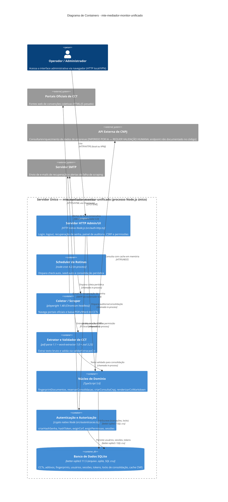
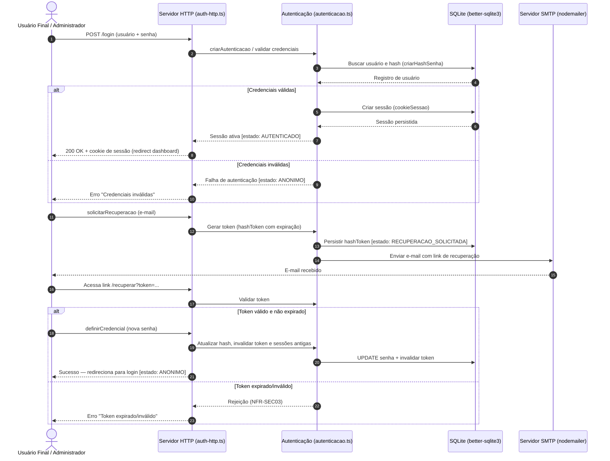
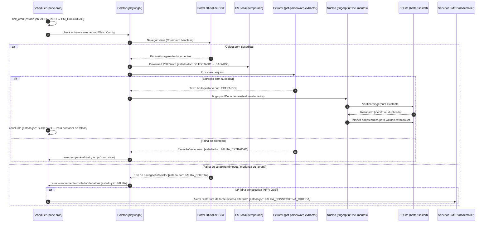
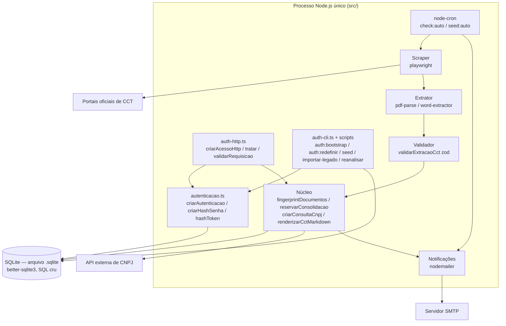
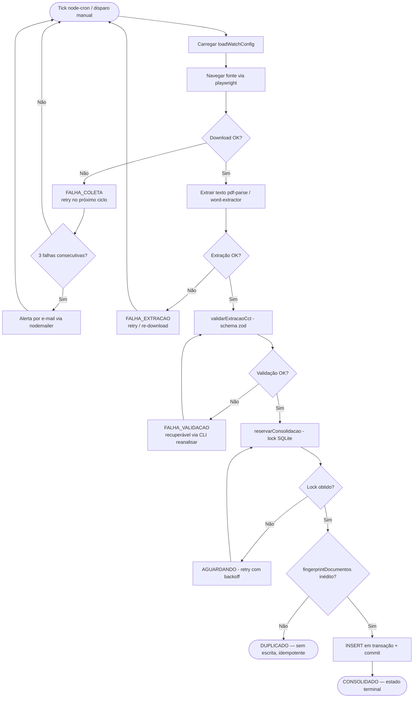

# UML & C4 Diagrams (Diagram as Code) — mte-mediador-monitor-unificado

> **Versão:** 1.0 · **Owner:** Arquitetura/Eng Lead · **Status:** Draft
> Este artefato segue a abordagem **Diagram as Code (DaC)**: os diagramas são texto versionado (Mermaid), nunca imagens estáticas coladas aqui. Toda alteração de arquitetura relevante deve atualizar este arquivo no mesmo PR que altera o código.
>
> **Fontes:** System Architecture Document (SAD), User Flows, State Machines (FSM), diagnóstico determinístico do workspace. Elementos não detectados diretamente no código estão marcados com **[INFERIDO POR IA — REQUER VALIDAÇÃO HUMANA]**.

## 1. Diagrama de Containers (C4 Model — Nível 2)

A topologia real é um **monolito single-process Node.js/TypeScript**: um único processo hospeda o scheduler (`node-cron`), o scraper (`playwright`), o pipeline de extração (`pdf-parse`/`word-extractor`), o servidor HTTP próprio (`auth-http.ts`) e a persistência em arquivo SQLite (`better-sqlite3`, SQL cru, sem ORM). **Não há** API Gateway, load balancer, message broker, cache distribuído ou réplicas — nada disso existe na stack verificada.



**Notas de topologia:**
- Todos os containers dentro do boundary compartilham o **mesmo event loop e o mesmo arquivo `.sqlite`** — a comunicação é síncrona, in-process (chamadas de função TypeScript). Não há IPC, filas ou eventos distribuídos.
- O backup é cópia periódica do arquivo `.sqlite` para destino externo (NFR-A02/A03) — mecanismo de backup específico **[INFERIDO POR IA — REQUER VALIDAÇÃO HUMANA]**.
- Health-check (`/healthz`) e endpoint de métricas **não estão implementados** (NFR-O03) — omitidos do diagrama por não existirem no código.

## 2. Diagramas de Sequência (Fluxos Críticos)

Derivados dos fluxos reais documentados no artefato **User Flows** (Flows 1–3) e das FSMs do artefato **State Machines**. Como as FSMs são inferidas (não há colunas de estado detectadas no schema), os estados referenciados carregam a mesma ressalva de validação.

### 2.1 Autenticação e Recuperação de Acesso (Flow 1)

Referencia a FSM de Sessão (`ANONIMO → AUTENTICADO`, `RECUPERACAO_SOLICITADA`).



### 2.2 Monitoramento e Extração de CCTs (Flow 2)

Referencia a FSM do Documento CCT (`DETECTADO → BAIXADO → EXTRAIDO`) e a FSM do Job de Coleta (`AGENDADO → EM_EXECUCAO → SUCESSO/FALHA`).



### 2.3 Auditoria e Consolidação de Dados (Flow 3)

Referencia a FSM do Documento CCT (`EXTRAIDO → VALIDADO → CONSOLIDADO/DUPLICADO`) e a FSM da Reserva de Consolidação (`LIVRE → RESERVADO/AGUARDANDO → LIBERADO`).

```mermaid
sequenceDiagram
    autonumber
    actor Operador as Operador de Cadastro / Analista Jurídico
    participant HTTP as Servidor HTTP (auth-http.ts)
    participant Auth as exigirCsrf + exigirPermissao
    participant Core as Núcleo de Domínio
    participant DB as SQLite (better-sqlite3)

    Operador->>HTTP: Acessar painel de auditoria
    HTTP->>Auth: Validar sessão (cookieSessao), CSRF e permissão
    alt Sessão válida e autorizada
        Auth-->>HTTP: OK [estado sessão: AUTENTICADO]
        Operador->>HTTP: Executar validarExtracaoCct(documento)
        HTTP->>Core: Validar schema (zod)
        alt Dados corretos
            Core-->>HTTP: Aprovado [estado doc: EXTRAIDO → VALIDADO]
            Operador->>HTTP: Executar validarAlteracoes (evidências)
            HTTP->>Core: reservarConsolidacao
            Core->>DB: Adquirir lock de escrita (tabela de locks)
            alt Lock disponível
                DB-->>Core: RESERVADO
                Core->>DB: Verificar fingerprintDocumentos
                alt Fingerprint inédito
                    Core->>DB: INSERT consolidação (transação) + commit
                    DB-->>Core: OK [estado doc: CONSOLIDADO; lock: LIBERADO]
                    HTTP-->>Operador: renderizarCctMarkdown — documento final
                else Fingerprint já existente
                    Core->>DB: rollback / sem escrita [estado doc: DUPLICADO — idempotência NFR-A04]
                    HTTP-->>Operador: "Documento já consolidado"
                end
            else Lock ocupado por outra rotina
                DB-->>Core: AGUARDANDO (retry com backoff — NFR-P02)
                alt Timeout de tentativas
                    Core-->>HTTP: Lock não obtido [lock: LIBERADO; doc permanece VALIDADO]
                    HTTP-->>Operador: "Documento está sendo consolidado por outro usuário"
                end
            end
        else Falha de validação
            Core-->>HTTP: Rejeitado [estado doc: FALHA_VALIDACAO — recuperável via CLI reanalisar]
            HTTP-->>Operador: "Falha ao processar arquivo. Verifique a integridade do documento fonte."
        end
    else Sessão expirada ou sem permissão
        Auth-->>HTTP: Rejeição (exigirPermissao / exigirCsrf)
        HTTP-->>Operador: Redirect login — "Sua sessão expirou"
    end
```

## 3. Diagrama de Componentes (visão estática)

Visão interna do processo único, útil porque o diagrama de containers não evidencia o acoplamento in-process entre módulos de `src/` e o acesso compartilhado ao SQLite.



## 4. Diagrama de Casos de Uso / Atividade

Fluxo lógico consolidado do pipeline de documentos, alinhado à FSM principal do artefato State Machines **[INFERIDO POR IA — REQUER VALIDAÇÃO HUMANA]** (estados não confirmados em colunas de schema, pois não há `schema.sql` versionado).



## 5. Convenções de Manutenção

- **Fonte única da verdade:** este arquivo é gerado/atualizado pelo próprio fluxo de documentação — não editar diagramas fora deste artefato.
- **Sem binários:** nunca anexar `.png`/`.jpg`/`.drawio`; o diagrama é sempre o bloco Mermaid acima.
- **Atualização obrigatória:** qualquer PR que altere fluxos entre módulos de `src/`, contratos do servidor HTTP (`auth-http.ts`), integrações externas (portais, SMTP, CNPJ) ou a topologia de nó único deve atualizar a seção correspondente aqui.
- **Validações humanas pendentes:** (1) confirmar no código o endpoint real da API de CNPJ; (2) confirmar a existência da tabela de locks e das colunas de estado no SQLite antes de promover as FSMs a contrato; (3) confirmar o mecanismo de backup do arquivo `.sqlite`.