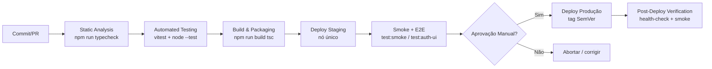

# CI/CD & Release Plan — mte-mediador-monitor-unificado

> **Owner:** Engenharia/DevOps · **Ferramenta de CI/CD:** `[INFERIDO POR IA — REQUER VALIDAÇÃO HUMANA]` GitHub Actions (premissa: nenhum arquivo de pipeline — `.github/workflows/`, `.gitlab-ci.yml`, `Jenkinsfile` — foi detectado no workspace; GitHub Actions é a hipótese adotada por ser a opção mais comum para projetos Node.js hospedados em Git, mas **precisa ser confirmada e o workflow efetivamente criado**).
>
> *Nota de Transparência:* Ferramentas, comandos ou ambientes não explicitados nos arquivos do projeto ou nos artefatos-fonte (`system-architecture`, `test-strategy`, `dev-environment`, `nfr`) estão identificados com `[INFERIDO POR IA — REQUER VALIDAÇÃO HUMANA]`.

## 1. Pipeline Overview

**Restrições da topologia real (SAD §11):** aplicação monolítica Node.js/TypeScript de processo único, banco `better-sqlite3` em arquivo local, sem containers, sem load balancer, sem réplicas. O pipeline **não** inclui build de imagem Docker, push para registry de containers, nem estratégias multi-nó (canary/blue-green distribuído) — deploy é a substituição do artefato compilado em um único servidor com reinício do processo.

## 2. Pipeline Stages

### Stage 1: Static Analysis
* **Ferramentas (reais):**
  - `npm run typecheck` — TypeScript 5.6 estrito (`tsc --noEmit`), gate obrigatório por NFR-M03.
  - `npm audit` — auditoria de dependências `[INFERIDO POR IA — REQUER VALIDAÇÃO HUMANA]` (sugerido no SAD §13; nenhum SAST/DAST instalado).
  - Verificação de `console.*` residuais em `src/` — meta zero (NFR-SEC04); implementação como script de grep no CI `[INFERIDO POR IA — REQUER VALIDAÇÃO HUMANA]` (não há ESLint/Biome instalado).
* **Critério de bloqueio:** qualquer falha de tipagem, vulnerabilidade crítica em `npm audit` ou `console.*` em `src/` = pipeline vermelho, merge bloqueado.

### Stage 2: Automated Testing
* **Escopo (scripts reais do `package.json`, ordem definida na Test Strategy §7):**
  1. `npm run test` — suite Vitest 2.1 completa (unit tests);
  2. `npm run test:smoke` (`test/template-cct.smoke.mjs`), `npm run test:status` (`test/analysis-state.smoke.mjs`), `npm run test:gmail` (`test/gmail-wizard.smoke.mjs`), `npm run test:review` (`test/revisoes.smoke.mjs`) — smoke/integration via `node --test`;
  3. `npm run test:clientes` — suite Vitest de clientes.
* **Cobertura mínima exigida:** 80% global; 95% nos módulos críticos (`autenticacao.ts`, `auth-http.ts`, CNPJ, `fingerprintDocumentos`, `validarExtracaoCct`, `reservarConsolidacao`) `[INFERIDO POR IA — REQUER VALIDAÇÃO HUMANA]` (NFR-M02 exige cobertura dos fluxos críticos, mas não define percentual numérico).
* **Pré-requisito de ambiente no CI:** `npm run playwright:install` para os testes que dependem de browser; banco SQLite efêmero em diretório temporário; `.env` de teste sem credenciais reais.

### Stage 3: Build & Packaging
* **Artefato gerado (real):** saída de `npm run build` → `tsc -p tsconfig.json` (JavaScript compilado). Não há empacotamento Tauri, Docker ou binário standalone.
* **Empacotamento:** `[INFERIDO POR IA — REQUER VALIDAÇÃO HUMANA]` tarball do diretório de build + `package.json`/`package-lock.json` (ex: `npm pack` ou `tar.gz` versionado), uma vez que não há registry de artefatos definido nos fontes.
* **Registry/Storage:** `[INFERIDO POR IA — REQUER VALIDAÇÃO HUMANA]` GitHub Releases / GitHub Packages como storage de artefatos (premissa: nenhum registry detectado no projeto).
* **Tagging:** `v<MAJOR.MINOR.PATCH>` (SemVer) no repositório Git + artefato nomeado `mte-mediador-monitor-unificado-vX.Y.Z.tar.gz`; builds intermediários identificados por `sha-<commit>`.

### Stage 4: Deploy to Staging
* **Estratégia:** `[INFERIDO POR IA — REQUER VALIDAÇÃO HUMANA]` automático a cada merge para `main`, via cópia do artefato para o servidor de staging (ex: `rsync`/SSH) e reinício do processo (systemd ou restart policy equivalente — SAD §11).
* **Dados:** cópia **anonimizada** dos dados legados (Test Strategy §3); SMTP de teste; serviço de CNPJ em sandbox `[INFERIDO POR IA — REQUER VALIDAÇÃO HUMANA]`.
* **Validação pós-deploy (scripts reais):**
  - `npm run test:auth-ui` e `npm run test:clientes-ui` — E2E Playwright;
  - `npm run check:dry` — deve reportar zero inconsistências antes de qualquer release que toque migração;
  - `npm run seed:auto` / `importar-legado` executados em staging para homologação (DoD US-005).

### Stage 5: Deploy to Production
* **Gatilho:** manual, com aprovação (ver §6), após bake time em staging `[INFERIDO POR IA — REQUER VALIDAÇÃO HUMANA]` (sugerido: mínimo 24h de observação em staging, dado o ciclo de rotinas `node-cron` — NFR-A01 exige 99% de uptime das rotinas, e um ciclo completo de coleta precisa ser observado antes de promover).
* **Estratégia de rollout:** **nenhuma das estratégias multi-nó se aplica** (sem blue-green/canary/rolling — topologia de nó único, NFR-S01). O rollout é: (1) backup do arquivo `.sqlite` e do `.env` (obrigatório, alinhado a NFR-A02/A03); (2) parada do processo; (3) substituição do artefato; (4) `npm run start`; (5) verificação pós-deploy (§7).
* **Janela de deploy:** `[INFERIDO POR IA — REQUER VALIDAÇÃO HUMANA]` fora do horário de execução das rotinas críticas de coleta (`check:auto` via `node-cron`), preferencialmente início do dia útil, evitando sextas-feiras — para maximizar o tempo de reação dentro do RTO de 4h (NFR-A02).

## 3. Release Strategy

* **Versionamento:** SemVer (MAJOR.MINOR.PATCH):
  - **MAJOR:** mudança incompatível de schema do SQLite, de formato de dados migrados (`importar-legado`) ou de comportamento de autenticação/autorização;
  - **MINOR:** nova funcionalidade retrocompatível (ex: novo fluxo de coleta, novo endpoint admin);
  - **PATCH:** correções de bug, ajustes de seletores de scraping (US-011), refatorações sem mudança de comportamento (ex: redução de complexidade — NFR-M01).
* **Cadência de release:** `[INFERIDO POR IA — REQUER VALIDAÇÃO HUMANA]` por sprint / sob demanda, com hotfixes PATCH fora de ciclo para quebra de coleta (seletores Playwright) ou incidentes P0/P1 (Test Strategy §8).
* **Feature Flags:** **nenhuma ferramenta de feature flag detectada no código.** `[INFERIDO POR IA — REQUER VALIDAÇÃO HUMANA]` Para o estágio atual, recomenda-se não introduzir sistema de flags; mudanças sensíveis (ex: novo fluxo de consolidação) devem ser protegidas por variável de ambiente no `.env` até prova em staging.
* **Branching model:** `[INFERIDO POR IA — REQUER VALIDAÇÃO HUMANA]` trunk-based development: PRs curtos para `main`, tags `vX.Y.Z` em `main` para releases (premissa: nenhuma política de branching detectada no workspace).

## 4. Environments

| Ambiente | Propósito | URL | Deploy automático? | Dados |
| :--- | :--- | :--- | :--- | :--- |
| Development | Desenvolvimento e testes unitários/smoke locais | `localhost` (porta via `.env`) | N/A (local, `npm run dev` com `tsx watch`) | Sintéticos via `npm run seed` |
| CI | Validação de PR (typecheck + Vitest + smoke) | N/A (runner efêmero) | Sim (a cada PR) | SQLite efêmero, `.env` de teste |
| Staging | Homologação pré-produção, E2E, migração | `[INFERIDO POR IA — REQUER VALIDAÇÃO HUMANA]` — URL/host não definidos nos fontes | Sim (merge em `main`) `[INFERIDO POR IA — REQUER VALIDAÇÃO HUMANA]` | Cópia anonimizada dos legados |
| Production | Operação real (coleta, consolidação, admin) | `[INFERIDO POR IA — REQUER VALIDAÇÃO HUMANA]` — URL/host não definidos nos fontes; acesso via VPN/local (SAD §9) | Não — manual com gate de aprovação | Reais |

## 5. Rollback Strategy

* **Gatilho de rollback:**
  - Falha de health-check pós-deploy (NFR-O03) ou smoke test de produção falhando;
  - Rotinas `node-cron` não executando ou falhando em todas as fontes (P1 — Test Strategy §8);
  - Corrupção/erro de escrita no `.sqlite` após deploy (P0);
  - Qualquer bug P0/P1 introduzido pela release.
* **Mecanismo (alinhado à topologia de nó único):**
  1. **Reversão de artefato:** parar o processo, restaurar o artefato da tag SemVer anterior (`vX.Y.Z-1`), reiniciar com `npm run start`;
  2. **Reversão de dados:** se a release executou migração de schema ou `importar-legado`, restaurar o backup do arquivo `.sqlite` feito imediatamente antes do deploy (obrigatório no runbook de deploy);
  3. **Reversão de configuração:** restaurar `.env` anterior se variáveis mudaram;
  4. **Kill switch por configuração:** `[INFERIDO POR IA — REQUER VALIDAÇÃO HUMANA]` desativar funcionalidade problemática via variável de ambiente quando aplicável (não há feature flags formais).
* **Tempo alvo de rollback:** ≤ 1h `[INFERIDO POR IA — REQUER VALIDAÇÃO HUMANA]` — confortavelmente dentro do RTO de 4h (NFR-A02); a restauração do `.sqlite` deve respeitar o RPO de 24h (NFR-A03), ou seja, o backup pré-deploy elimina perda de dados do próprio deploy.
* **Rollback de migração:** deve ser **testado em staging antes da release** (critério de saída da Test Strategy §7: "rollback de migração testado e documentado").

## 6. Approval Gates

| Gate | Ambiente | Aprovador | SLA |
| :--- | :--- | :--- | :--- |
| Merge para `main` | CI | Eng Lead (revisão de PR + pipeline verde) | `[INFERIDO POR IA — REQUER VALIDAÇÃO HUMANA]` 2 dias úteis |
| Deploy Produção | Prod | Eng Lead (gate de qualidade — critérios da Test Strategy §7: suite verde em staging, `check:dry` sem erros, 0 bugs P0/P1) | `[INFERIDO POR IA — REQUER VALIDAÇÃO HUMANA]` 1 dia útil |
| Release com migração de dados | Prod | Eng Lead + PO (validação de 100% dos vínculos empresa↔CCT preservados — DoD US-005) | `[INFERIDO POR IA — REQUER VALIDAÇÃO HUMANA]` a definir com PO |
| Hotfix P0 | Prod | Eng Lead (aprovação expedita, deploy imediato — SLA P0 ≤ 4h, alinhado ao RTO NFR-A02) | ≤ 4h |

## 7. Post-Deploy Verification

- [ ] Processo Node.js ativo após `npm run start` (verificação via systemd/restart policy)
- [ ] Health-check respondendo (`/healthz` — NFR-O03; **endpoint ainda não implementado** — SAD §10 — até lá, verificação manual de conectividade SQLite + SMTP) `[INFERIDO POR IA — REQUER VALIDAÇÃO HUMANA]`
- [ ] Smoke tests de produção em modo somente-leitura verdes (Test Strategy §3)
- [ ] Próxima execução agendada do `node-cron` (`check:auto`) observada com sucesso — janela de observação de pelo menos 1 ciclo de coleta
- [ ] Nenhum erro crítico novo nos logs em `[INFERIDO POR IA — REQUER VALIDAÇÃO HUMANA]` 24h de observação (período alinhado ao ciclo das rotinas e ao RPO NFR-A03)
- [ ] Integridade do `.sqlite` verificada (abertura do banco + `check:dry` sem inconsistências)
- [ ] Comunicação de release enviada aos stakeholders (se aplicável) `[INFERIDO POR IA — REQUER VALIDAÇÃO HUMANA]`

## 8. Secrets & Configuration Management

* **Mecanismo real (detectado):** variáveis de ambiente via arquivo `.env` (não versionado), carregado com `dotenv` 16.4 — inclui segredos SMTP (`SMTP_HOST`, `SMTP_PORT`, `SMTP_USER`, `SMTP_PASS`), segredo de sessão/token e porta HTTP (SAD §6/§11). Bootstrap de credenciais administrativas via `npm run auth:bootstrap` e redefinição via `npm run auth:redefinir`.
* **Ferramenta de gestão de segredos em CI:** `[INFERIDO POR IA — REQUER VALIDAÇÃO HUMANA]` GitHub Secrets (premissa acoplada à escolha de GitHub Actions; nenhum Vault/Secrets Manager detectado). Segredos de produção **nunca** no repositório nem em logs — alinhado a NFR-SEC04 (eliminação dos 26 `console.*` residuais é gate de release).
* **Distribuição para o servidor:** `[INFERIDO POR IA — REQUER VALIDAÇÃO HUMANA]` `.env` de produção provisionado manualmente no host (fora do artefato de build), com permissões restritas de arquivo; o artefato de deploy não contém segredos.
* **Política de rotação:** `[INFERIDO POR IA — REQUER VALIDAÇÃO HUMANA]` rotação de segredos SMTP e de sessão a cada 90 dias ou imediatamente em caso de suspeita de vazamento; tokens de recuperação já possuem expiração via `hashToken` (NFR-SEC03). Premissa: nenhuma política de rotação formalizada nos fontes — requer definição pelo Eng Lead junto ao responsável de infraestrutura.
* **Backup como parte da configuração:** o runbook de deploy/rollback depende de backup periódico do `.sqlite` + `.env` (NFR-A02/A03); a frequência exata do backup é **estratégia operacional a definir** (NFR-A03) — `[INFERIDO POR IA — REQUER VALIDAÇÃO HUMANA]` sugerido backup diário para atender RPO ≤ 24h.