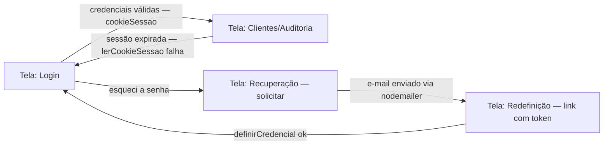

# Wireframes & Protótipos — MTE Mediador Monitor Unificado

> **Versão:** 1.0 · **Owner:** [Design/Product — a definir] · **Status:** Draft
> **Depende de:** [user-flows.md, component-library.md, accessibility-guidelines.md, design-tokens.md]

## 1. Overview

Este documento registra os wireframes das telas do MTE Mediador Monitor Unificado. **Restrição fundamental de origem:** a varredura determinística do workspace **não detectou nenhuma página/tela frontend formalmente identificável** (sem rotas de framework, sem componentes React, sem templates nomeados). O que existe de fato no código são **duas folhas de estilo** — `web/auth-ui.css` (tela(s) de autenticação) e `web/clientes-ui.css` (tela de clientes) — que estilizam HTML servido server-side pelo backend monolítico (`src/auth-http.ts`).

Consequentemente, **todos os wireframes deste documento são [INFERIDO POR IA — REQUER VALIDAÇÃO HUMANA]**: foram reconstruídos a partir (a) da existência dos arquivos CSS, (b) dos fluxos documentados em user-flows.md (Flow 1: Autenticação; Flow 3: Auditoria/Clientes) e (c) dos 4 tokens visuais reais (`--bg: #f1f1ef`, `--ink: #18181b`, `--muted: #62626b`, `--line: #dedee3` — `web/auth-ui.css:2`). Nenhum wireframe aqui descreve marcação HTML confirmada no repositório.

## 2. Escopo & Objetivo do Protótipo

* **Problema a resolver:** dar forma visual mínima e acessível aos dois únicos pontos de contato humano do sistema — autenticação (Flow 1) e gestão/auditoria de clientes (Flow 3) — usando exclusivamente os tokens existentes, sem inventar telas que o backend não serve.
* **Fluxo(s) coberto(s):** Flow 1 (Autenticação e Recuperação de Acesso) e Flow 3 (Auditoria e Consolidação de Dados) de user-flows.md. O Flow 2 (Monitoramento/Extração) é executado por `node-cron` + `playwright` em background e **não possui tela confirmada** — qualquer painel de monitoramento seria tela nova e está fora deste escopo.
* **Fidelidade:** Low-fidelity (wireframe estrutural em ASCII). Não há base para hi-fi: faltam tokens semânticos (`--danger`, `--accent`), tipografia e espaçamentos tokenizados (lacunas registradas em design-tokens.md e component-library.md).
* **Interativo?** Não (estático). Não existe ferramenta de prototipação vinculada ao repositório.

## 3. Inventário de Telas

| Tela | Descrição | Fidelidade | Status | Link |
| :--- | :--- | :--- | :--- | :--- |
| Login | Autenticação via `criarAutenticacao`; estilos em `web/auth-ui.css` | Low-fi | [INFERIDO POR IA — REQUER VALIDAÇÃO HUMANA] | — |
| Recuperação de Senha (solicitar) | Aciona `solicitarRecuperacao` + envio via `nodemailer` | Low-fi | [INFERIDO POR IA — REQUER VALIDAÇÃO HUMANA] | — |
| Redefinição de Senha | `definirCredencial` após validação de `hashToken` | Low-fi | [INFERIDO POR IA — REQUER VALIDAÇÃO HUMANA] | — |
| Clientes / Painel de Auditoria | Listagem e ações de auditoria; estilos em `web/clientes-ui.css` | Low-fi | [INFERIDO POR IA — REQUER VALIDAÇÃO HUMANA] | — |

> Nenhuma tela adicional (dashboard, monitoramento, configurações) foi incluída: não há evidência delas no código e a instrução do projeto proíbe inventar páginas não detectadas.

## 4. Fluxo Prototipado



Transições reais: não há rotas de framework detectadas; as transições acima refletem a lógica server-side documentada em user-flows.md (`cookieSessao`, `solicitarRecuperacao`, `definirCredencial`). As URLs exatas precisam ser confirmadas em `src/auth-http.ts`.

## 5. Especificação por Tela

### 5.1 Login [INFERIDO POR IA — REQUER VALIDAÇÃO HUMANA]

* **Fluxo:** Flow 1 — passos 1 e 6.
* **Objetivo do usuário:** entrar no sistema com e-mail e senha.
* **Componentes utilizados (propostos em component-library.md):** LoginForm, TextInput (e-mail, senha), Button primary, Alert/ErrorMessage.
* **Estados da tela:** Default; Loading (durante validação de hash de senha); Error ("Usuário não encontrado" / "Credenciais inválidas"); Success (redirect para Clientes).

```
+--------------------------------------------------+
|                                                  |
|              MTE Mediador Monitor                |
|                                                  |
|   +------------------------------------------+   |
|   | E-mail                                   |   |
|   | [__________________________________]     |   |
|   |                                          |   |
|   | Senha                                    |   |
|   | [__________________________________]     |   |
|   |                                          |   |
|   | [ Entrar ]                               |   |
|   |                                          |   |
|   | Esqueci minha senha  -->                 |   |
|   +------------------------------------------+   |
|                                                  |
+--------------------------------------------------+
 Hierarquia visual (tokens reais):
  fundo da página: --bg #f1f1ef
  texto/labels:    --ink #18181b
  texto auxiliar:  --muted #62626b
  bordas do card:  --line #dedee3
```

* **Regras de negócio:** validação via `criarAutenticacao`; sucesso cria `cookieSessao`.
* **Anotações de interação:** submit por Enter; erro exibido como texto (não apenas cor de borda — `--line` tem contraste ≈1.3:1, ver accessibility-guidelines.md §3); `autocomplete="current-password"` e paste permitido (WCAG 3.3.8).
* **Responsividade:** [INFERIDO POR IA] card centralizado de largura fixa em desktop, fluido em mobile — sem breakpoints confirmados no CSS; verificar `web/auth-ui.css`.

### 5.2 Recuperação de Senha — solicitar [INFERIDO POR IA — REQUER VALIDAÇÃO HUMANA]

* **Fluxo:** Flow 1 — passos 2 e 3.
* **Objetivo:** informar e-mail para receber token de recuperação.
* **Componentes:** RecoveryForm, TextInput (e-mail), Button primary, Alert (success/error).

```
+--------------------------------------------------+
|   Recuperar acesso                               |
|                                                  |
|   Informe o e-mail vinculado à sua conta.        |
|                                                  |
|   E-mail                                         |
|   [__________________________________]           |
|                                                  |
|   [ Enviar link de recuperação ]                 |
|                                                  |
|   <-- Voltar para o login                        |
+--------------------------------------------------+
 Estado success: "Se o e-mail estiver cadastrado,
 você receberá um link em instantes." (texto --ink)
```

* **Regras de negócio:** `solicitarRecuperacao` gera `hashToken` e envia e-mail via `nodemailer`. Mensagem de sucesso **não deve confirmar** se o e-mail existe (boa prática de segurança — [INFERIDO POR IA]).
* **Estados:** Default, Loading (envio de e-mail), Success, Error.

### 5.3 Redefinição de Senha [INFERIDO POR IA — REQUER VALIDAÇÃO HUMANA]

* **Fluxo:** Flow 1 — passos 4 e 5.
* **Objetivo:** definir nova senha a partir do link com token.
* **Componentes:** RecoveryForm (variante redefinir), TextInput (nova senha ×2), Button primary, Alert.

```
+--------------------------------------------------+
|   Definir nova senha                             |
|                                                  |
|   Nova senha                                     |
|   [__________________________________]           |
|                                                  |
|   Confirmar nova senha                           |
|   [__________________________________]           |
|                                                  |
|   [ Salvar nova senha ]                          |
+--------------------------------------------------+
 Estado error: "Token expirado ou inválido.
 Solicite um novo link." + link para 5.2
```

* **Regras de negócio:** valida `hashToken`; sucesso executa `definirCredencial` e redireciona ao Login. `autocomplete="new-password"`.
* **Estados:** Default, Loading, Error (token inválido/expirado), Success.

### 5.4 Clientes / Painel de Auditoria [INFERIDO POR IA — REQUER VALIDAÇÃO HUMANA]

* **Fluxo:** Flow 3 — passos 1 a 6 (a tela de clientes é o único candidato real, via `web/clientes-ui.css`, a hospedar as ações de auditoria).
* **Objetivo:** listar clientes/documentos e executar `validarExtracaoCct`, `validarAlteracoes`, consolidar e `renderizarCctMarkdown`.
* **Componentes:** ClientesTable/AuditPanel, Button primary, Alert/ErrorMessage, SessionGuard (server-side).

```
+--------------------------------------------------+
| Clientes / Auditoria              [usuario] Sair |
+--------------------------------------------------+
|                                                  |
|  +--------------------------------------------+  |
|  | Cliente/CNPJ      | Documento   | Status   |  |
|  |-------------------+-------------+----------|  |
|  | ...               | CCT 2024    | Extraído |  |
|  | ...               | CCT 2024    | Erro     |  |
|  +--------------------------------------------+  |
|                                                  |
|  Ações do item selecionado:                      |
|  [ Validar extração ] [ Validar alterações ]     |
|  [ Consolidar ]       [ Renderizar Markdown ]    |
|                                                  |
+--------------------------------------------------+
 Estado empty:  "Nenhum documento disponível para
                 auditoria." (texto --muted)
 Estado disabled: botão [ Consolidar ] bloqueado
                 quando reservarConsolidacao ativo,
                 com mensagem "Este documento está
                 sendo consolidado por outro usuário."
```

* **Regras de negócio:** consolidação protegida por `reservarConsolidacao` (concorrência); sessão validada por `lerCookieSessao`/`exigirPermissao` — expiração redireciona ao Login com "Sua sessão expirou".
* **Anotações de interação:** tabela deve ser `<table>` semântica com `<th scope="col">` (accessibility-guidelines.md §5); falhas de extração exibidas como texto "Erro de Extração", nunca só por cor.
* **Responsividade:** [INFERIDO POR IA] tabela com rolagem horizontal em telas estreitas — não confirmado em `web/clientes-ui.css`; verificar se o arquivo consome as variáveis de `auth-ui.css` ou usa valores hardcoded (lacuna aberta em component-library.md §6).

## 6. Feedback & Iterações

| Data | Autor | Feedback | Resolução |
| :--- | :--- | :--- | :--- |
| — | — | Nenhuma rodada de feedback registrada — documento em primeira versão, inteiramente inferido | Pendente de revisão humana |

## 7. Critérios de Aprovação

* [ ] Fluxo validado contra `user-flows.md` (Flows 1 e 3)
* [ ] Componentes existentes reutilizados — **bloqueado:** não há componentes implementados; aprovação depende de validar as propostas de component-library.md
* [ ] Estados de erro/vazio/loading cobertos (parcial: cobertos conceitualmente; tokens semânticos de erro inexistentes)
* [ ] Revisado por stakeholder de produto
* [ ] Acessibilidade básica validada contra accessibility-guidelines.md (foco visível, labels, contraste)

## 8. Handoff para Desenvolvimento

* **Especificações de medidas/spacing:** **inexistentes** — não há tokens de espaçamento/tipografia no código; definir em design-tokens.md antes do handoff.
* **Assets exportados:** nenhum — o projeto não possui biblioteca de ícones nem imagens de UI detectadas.
* **Componentes novos necessários:** todos os listados em component-library.md §3.2 (LoginForm, RecoveryForm, TextInput, Button, Alert, ClientesTable) precisam ser formalizados antes de qualquer implementação nova.
* **Bloqueadores de handoff:** (1) confirmar o HTML real servido por `src/auth-http.ts` e a tela de clientes; (2) definir `--accent`, token de foco e `--danger`; (3) verificar relação `auth-ui.css` ↔ `clientes-ui.css`.

## 9. Referências

* Não há arquivo de design (Figma ou similar) nem protótipo interativo vinculado ao repositório.
* `web/auth-ui.css:2` — tokens `--bg`, `--ink`, `--muted`, `--line` usados na hierarquia visual dos wireframes.
* `web/clientes-ui.css` — estilos da tela de clientes (sem variáveis próprias detectadas).
* user-flows.md — Flows 1 e 3, origem das telas e transições.
* component-library.md — inventário (inferido) de componentes referenciados.
* accessibility-guidelines.md — restrições de contraste, foco e formulários aplicadas aos wireframes.